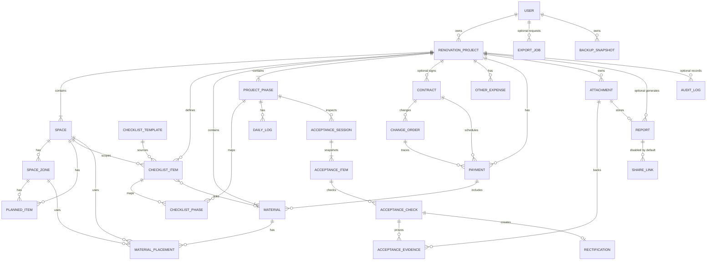

# 业主装修管理系统 — 产品需求文档 (PRD)

> 文档修订版：r1.7 | 产品模式：个人私用 | 目标产品版本：v1.0 | 日期：2026-09-03 | 状态：Review
>
> r1.7 变更：将产品从“装修记录工具”收敛为“业主自管理控制台”；补齐行动待办/决策、现场问题闭环、项目联系人、采购下单与到货节点、付款条件和关键变更历史；允许施工阶段并行；统一简单预算与预测口径，首页优先回答“现在要做什么、什么有风险、什么要到货、什么该付款”。
>
> r1.6 变更：根据“仅个人维护装修进度与注意项”的使用边界，移除商业化、公开试用、收费、协作者和公开分享假设；将本地/私有数据、进度、注意事项、材料、照片、验收和备份设为核心，合同/增减项、报告分享、市场指标与复杂账号治理降为可选或后续。
>
> r1.5 变更：补充目标市场与首要用户、竞品定位、MVP 假设与成功指标；将合同/增减项、统一证据资产、轻量分享、账号生命周期与审计列入 v1.0；修正阶段映射、跨阶段事项、成本承诺和发布门禁口径。
>
> r1.4 变更：明确装修注意事项独立页面入口、八类施工阶段维度、组合筛选、URL 状态与页面验收规则。
>
> r1.3 变更：扩充 §3.3 全屋与分空间装修注意事项模板，增加风险等级、必验标记、验证方式与模板初始化规则。
>
> 上一版归档：[`docs/archive/PRD-v1.0-2026-07-06.md`](./archive/PRD-v1.0-2026-07-06.md)

---

## 1. 产品概述

### 1.0 个人私用模式约束

Reno v1.0 是**业主个人装修自管理工具**，服务一个业主本人维护和推进自己的装修项目，不作为 SaaS、商业服务、装修平台或对外产品发布。系统不仅记录“发生了什么”，还要持续回答“接下来要做什么、有哪些问题未闭环、近期什么要到货、什么款项满足付款条件、项目是否延期或超预算”。以下约束覆盖本文中所有“市场、分享、账号、部署和发布”描述：

- **单一所有者**：v1.0 只服务一个业主账号；不做协作者、成员、角色矩阵、施工方账号或监理账号。
- **私有数据**：默认本地运行或私有网络运行；照片、合同、地址和金额不产生公开 URL，不做公开分享链接。
- **核心任务**：管理项目进度、空间、注意事项、行动待办/决策、材料采购交付、预算与付款、施工日志、现场问题、照片证据、验收复核和备份/导出。
- **非核心能力**：完整合同生命周期、复杂合同承诺模型、不可变报告、异步导出任务、远程分享、埋点分析和商业化配置均不构成 v1.0 必须项。
- **无商业发布门禁**：不定义收费、用户增长、公开 SLA、服务终止、退款、客服或商业合规上线标准；只保留个人数据安全和可恢复性要求。

后文保留的 `Contract`、`ChangeOrder`、`Report`、`ShareLink`、`ExportJob`、`AuditLog` 等实体，如果未明确标注为“个人 v1.0 核心”，均视为可选扩展或迁移参考，不得反向扩大个人版范围。

### 1.1 背景与目标

业主装修管理系统（以下简称 **Reno**）是一个面向**业主本人**的个人装修自管理工具，帮助业主在装修全过程中完成规划、决策、采购、付款、现场跟进、问题整改、阶段验收和项目归档。

**核心目标：**

- 业主能够系统化规划每个房间的装修方案与注意事项，避免遗漏
- 清晰管理建材采购清单，明确每样建材用在哪里、买了多少、花了多少钱
- 按空间/品类/阶段查看材料、款项和其他费用，知道已经花了多少、还要买什么和预算剩余；合同对账属于可选扩展
- 记录施工进度与验收情况，装修过程有据可查
- 把临时决定、催办、到货、付款和现场问题转成可执行事项，减少依赖微信聊天和脑内记忆

### 1.2 用户角色

| 角色       | 说明                                           |
| ---------- | ---------------------------------------------- |
| **业主**   | 系统唯一用户（v1.0），管理自己的装修项目全流程 |
| **协作者** | 不纳入个人版；多人使用需另立需求和权限模型     |

> 本系统为业主个人工具，非物业公司 SaaS 平台。无物业审批、巡检、违规等管理环节。v1.0 不做多角色权限。

### 1.3 核心价值

| 价值点     | 说明                                                         |
| ---------- | ------------------------------------------------------------ |
| **不遗漏** | 内置各房间装修注意事项模板，按施工阶段提示风险               |
| **买得清** | 建材清单管理，明确要买什么、用在哪里、花多少钱               |
| **花得明** | 预算—材料—款项—其他费用统一记录，知道已经花了多少            |
| **管得住** | 待办、进度、问题、付款条件、照片证据和验收复核形成可执行闭环 |

### 1.4 MVP 边界（v1.0 必做 / 延后）

> 原则：**先保证“知道该做什么、问题能闭环、钱算得准、现场录得进”**，再做图表、协作、智能化。

#### 必做（v1.0）

| 能力       | 范围说明                                                                      |
| ---------- | ----------------------------------------------------------------------------- |
| 访问       | 单一业主登录或本机访问；不做注册增长、协作者、成员邀请和角色矩阵              |
| 项目管理   | 一个当前装修项目；支持归档历史项目；创建 / 编辑 / 归档 / 删除误建项目         |
| 空间规划   | 空间 + 基础分区；模板一键初始化；**不含**复杂图纸编辑                         |
| 注意事项   | 全屋 / 按空间管理 + 内置模板；可关联阶段 / 建材                               |
| 行动待办   | 任务 / 决策 / 催办 / 采购 / 付款等个人行动项；支持截止时间与业务关联          |
| 项目联系人 | 施工方、工长、工人、设计师、供应商等联系人档案；仅业务对象，不创建账号        |
| 建材管理   | 清单 + 使用位置 + 待购/下单/到货/安装 + 预计到货 + 退货/调整                  |
| 成本记录   | 总预算 + 材料 / 款项 / 其他费用；默认显示已花、待支出、预测总额和可用预算     |
| 施工进度   | 阶段可并行 + 主阶段标识 + 施工日志（文字 + 照片/文档证据）                    |
| 现场问题   | 施工中可随时创建问题；整改完成后由业主复核，验收失败也进入同一问题链          |
| 验收       | 阶段验收（从注意事项生成检查项）；通过 / 问题整改 / 复验                      |
| 关键留痕   | 金额修改、状态回退、删除、取消必验、问题/验收结果等保留轻量变更历史           |
| 私有附件   | 统一附件资产；本地/私有存储；支持备份和导出，不提供公开分享链接               |
| 首页提醒   | 今日/近期待办、未闭环问题、到货、付款、工期和预算风险；不做消息中心和远程推送 |

#### 明确延后

| 能力                     | 版本 | 说明                                       |
| ------------------------ | ---- | ------------------------------------------ |
| 甘特图 / 时间线 / 照片墙 | v1.1 | 视图增强                                   |
| 成本可视化图表           | v1.1 | 饼图 / 柱状图 / 趋势图                     |
| 装修知识库               | v1.1 | 独立内容模块                               |
| 浏览器推送 / 站外提醒    | v1.1 | v1.0 先保证站内卡片和提醒状态可追溯        |
| 完整站内消息中心         | v1.1 | MVP 用首页待办替代                         |
| 合同/增减项与复杂预测    | 可选 | 个人需要时再启用；不阻塞进度和注意事项主链 |
| 单阶段报告 / PDF / Excel | 可选 | 个人备份或交付需要时再增加                 |
| 协作者 / 公开分享        | 不做 | 个人版不提供成员、访客或公开链接           |
| 材料批量导入             | 可选 | 数据量较大时再增加                         |
| 图表、智能推荐、用量估算 | 后续 | 不影响个人版核心使用                       |

#### 默认决策（关闭开放问题）

| 议题       | 默认结论                                             |
| ---------- | ---------------------------------------------------- |
| 移动端 App | **不做原生 App**；Web 响应式即可                     |
| 多项目     | 允许归档历史项目；v1.0 只维护一个当前项目            |
| 协作者     | **不做**；仅业主本人                                 |
| 数据导出   | 提供个人备份；格式以 JSON/CSV + 附件目录为主         |
| 建材模板库 | **预置常用品类**；不预置全量商品库                   |
| 运行方式   | **本地或私有网络优先**；不承诺公有云服务             |
| 地域单位   | 中国大陆住宅、人民币、公制；模板仅作提醒，不代替规范 |

---

### 1.5 使用者假设与 JTBD（不构成市场目标）

#### 1.5.1 v1.0 首要用户假设

v1.0 仅描述当前使用者，不定义市场规模或商业成功标准：

| 维度     | 首要用户假设                                                           |
| -------- | ---------------------------------------------------------------------- |
| 人群     | 首次装修、愿意自己掌控关键决策的住宅业主                               |
| 装修方式 | **半包优先**；全包作为次要用户，清包暂不保证完整支持                   |
| 地域     | 中国大陆城市住宅；项目所在地决定模板适用性，不把经验参数当全国统一标准 |
| 阶段     | 开工前 1–2 个月开始使用，持续到完工归档                                |
| 使用场景 | 手机现场快速记录，桌面集中整理预算、材料和验收                         |
| 当前替代 | Excel / 备忘录 / 微信相册与聊天记录 / 装修公司自有工具                 |

这是个人使用假设而不是市场结论。先以一个真实装修项目连续使用 4 周，观察记录是否比 Excel、备忘录和微信聊天更容易维护；不建立用户增长、留存或商业转化目标。

#### 1.5.2 用户要完成的工作（JTBD）

- 打开项目时，我能立刻知道今天和未来几天要确认、催办、采购、付款或复核什么，而不是靠聊天置顶和脑内记忆。
- 在购买材料、支付款项或发生其他费用时，我能知道它如何改变预算剩余和预测总额，而不是只记一笔孤立金额；完整合同增项模型属于可选扩展。
- 在现场离开前，我能用很少的操作留下“哪个空间、哪个阶段、发生了什么、有什么证据”，并把发现的问题直接转成待整改事项。
- 在阶段验收时，我能把注意事项转成可执行检查项，失败后进入与现场问题一致的整改/复核链，而不是重新翻聊天记录。
- 在装修结束后，我能取回一份完整、可读、属于自己的项目档案，不依赖装修公司是否继续提供服务。

#### 1.5.3 明确不竞争的方向

Reno v1.0 不与内容社区、装修公司撮合、建材商城、3D 效果图平台或第三方专业监理服务竞争。相关链接可以作为外部附件或备注保存，但不纳入核心业务闭环，也不以供应商佣金为产品价值来源。

### 1.6 市场参考（不作为商业竞争目标）

截至 2026-08-07 的公开产品观察：

> 下面是官网 / 应用商店的厂商公开描述，不是独立测评；价格、服务城市和功能层级在发布前需再次核验。

| 公开产品                                                                                        | 主要强项                                            | Reno 的差异化判断                                                      |
| ----------------------------------------------------------------------------------------------- | --------------------------------------------------- | ---------------------------------------------------------------------- |
| [住小帮](https://www.zhuxiaobang.com/)                                                          | 案例、效果图、装修知识、服务与商品连接              | Reno 不做内容流量平台，重点是业主自己的结构化项目数据                  |
| [土巴兔](https://apps.apple.com/cn/app/id915299335)                                             | 找公司/设计师、报价、装修记账、顾问、质检与平台保障 | Reno 不绑定交易，提供中立的预算、证据和整改历史                        |
| [装小蜜](https://www.zhuangxiaomi.com/zhuangxiujianli/)                                         | 合同/报价审核、关键节点监理、照片日志、整改建议     | Reno 不替代专业监理，把业主日常记录与第三方报告放在同一档案中          |
| [magicplan](https://magicplan.app/) / [Buildertrend](https://apps.apple.com/us/app/id504370616) | 现场采集、估算、任务、文档、变更、报告与协作        | 这些产品主要面向专业施工方；Reno 只吸收现场证据和变更的关键数据结构    |
| [HomeZada](https://apps.apple.com/us/app/homezada-mobile/id473722482)                           | 房屋资产、票据、说明书、保修和家庭共享档案          | Reno 将“施工中”的阶段、预算和验收证据作为主链；竣工后的资产档案放 v2.0 |
| Excel / 备忘录 / 微信相册 / Notion                                                              | 上手快、灵活、无需迁移平台                          | Reno 以装修领域状态、成本防重复和证据关联降低长期维护与追溯成本        |

以上比较只用于借鉴信息结构和避开重复建设，不作为商业竞争、定价或市场进入依据。

个人版真正需要超越的是 Excel、备忘录和微信相册之间的信息割裂；专业施工管理产品只用于参考数据结构，不作为功能齐全度目标。

个人版后续不需要持续扩展竞品矩阵；只有当使用范围改成多人协作、对外分享或商业服务时，才重新做市场与合规评审。

**个人工具定位：**

> Reno 是业主自己的装修记录本：把空间、注意事项、材料、预算、施工日志、照片和验收整改放在一个私有项目里，随时知道下一步做什么。

**个人使用验证条件：** 业主应能在不翻找多个聊天记录的情况下，从项目首页找到某个阶段、某个注意事项、对应照片和整改状态，并能导出/备份自己的数据。

### 1.7 个人使用假设与验收指标

#### 1.7.1 v1.0 要验证的核心假设

| 假设                         | 验证方式                                   | 失败信号                                 |
| ---------------------------- | ------------------------------------------ | ---------------------------------------- |
| 业主愿意维护一份独立装修记录 | 连续使用同一个项目 4 周                    | 只初始化模板，之后仍回到微信/Excel       |
| 注意事项能减少遗漏           | 每个阶段实际使用模板并记录完成情况         | 项目结束后仍无法回答“哪些已做、哪些待做” |
| 现场记录足够轻量             | 记录 5 条日志/照片，观察完成时间和失败次数 | 记录步骤过长，导致信息继续散落在聊天记录 |
| 整改闭环有用                 | 完成至少一次失败检查、整改和复验           | 照片无法关联问题，复验仍靠手工查找       |

#### 1.7.2 指标定义

| 指标类型 | 指标           | 个人版口径                                               |
| -------- | -------------- | -------------------------------------------------------- |
| 可持续   | 四周持续记录   | 连续 4 周至少各有一条阶段、注意事项或日志记录            |
| 可执行   | 快速记录耗时   | 从选择阶段到保存文字/照片的中位时间，目标是不超过 1 分钟 |
| 可追溯   | 注意事项闭环率 | 已处理事项中，能够找到阶段、状态和备注/证据的比例        |
| 可恢复   | 备份恢复成功   | 导出的备份能在另一目录或另一台本机恢复并打开             |
| 数据质量 | 重复/丢失记录  | 不出现重复初始化、跨项目引用或上传后业务记录丢失         |

个人版不采集远程埋点，也不需要行业目标值；使用者可在本地查看记录数量、未完成事项和备份状态。所有地址、照片和金额只保存在个人数据目录中。

#### 1.7.3 本地状态字段（不上传）

| 字段                     | 用途                | 存储范围               |
| ------------------------ | ------------------- | ---------------------- |
| `lastOpenedAt`           | 最近一次打开项目    | 本地数据库             |
| `lastBackupAt`           | 最近一次成功备份    | 本地数据库             |
| `pendingAttachmentCount` | 待上传/待处理附件数 | 本地数据库             |
| `openChecklistCount`     | 未完成注意事项数    | 实时派生或本地缓存     |
| `lastErrorCode`          | 最近一次可恢复错误  | 本地日志，不含业务正文 |

这些字段不上传第三方服务；附件和业务数据仍以项目数据库为准，缓存损坏时可以重算或清空。

#### 1.7.4 纵向交付切片

- **个人主链 A：规划与记录**：项目 → 空间模板 → 注意事项 → 材料/预算 → 待办。
- **个人主链 B：现场与验收**：阶段 → 快速日志/照片 → 验收检查 → 整改 → 复验 → 备份。
- 只有 A、B 两条主链都能完成，才可以称为个人版 v1.0；页面数量、mock 数据或单模块 CRUD 不构成完成。

### 1.8 交付形态、范围与决策门禁

- 默认运行方式为本地开发服务器或私有网络部署；不设计注册增长、收费、云端试用、公开 SLA 或服务终止策略。
- 数据目录由使用者自行指定和备份；照片、地址、金额和日志默认不离开本机/私有网络。
- v1.0 使用人民币、公制和中国大陆住宅场景；模板只是提醒，不替代当地规范、设计或专业判断。
- 时间戳可按本机时间保存；如使用服务端，统一保存 UTC、按 `Asia/Shanghai` 展示即可，不做跨时区配置。
- 个人版验收只要求：核心记录可用、附件可打开、备份可恢复、删除误建数据不会破坏其他项目；无需商业发布签字。

### 1.9 产品风险与验证门禁

| 风险                 | 早期信号                       | 个人版缓解要求                                       | 负责人            |
| -------------------- | ------------------------------ | ---------------------------------------------------- | ----------------- |
| 手工录入成本高于收益 | 只初始化模板，4 周内无持续记录 | 快速记录、默认值、模板预览和一键复制                 | 使用者 / 前端     |
| 模板造成专业安全错觉 | 高风险项被当成合格结论         | 来源、地区、复核日期和免责声明；不硬编码全国统一参数 | 使用者 / 内容维护 |
| 金额录错或重复计费   | 总额无法和材料/款项明细对上    | 简单账本优先；保存前显示影响；保留修改记录           | 使用者 / 后端     |
| 弱网或文件损坏       | 照片上传失败、重复或无法打开   | 本地待上传状态、重试、checksum、备份和恢复检查       | 前端 / 后端       |
| 误删或数据损坏       | 删除项目后其他数据丢失         | 删除前确认、项目级备份、导出后再清理                 | 使用者 / 运维     |

---

## 2. 核心业务流程

### 2.1 装修准备流程

```
业主创建装修项目（设定地址、风格、预算、工期）
    ↓
创建空间规划（客厅/主卧/厨房/卫生间/阳台...）
    ↓
每个空间内划分分区（如厨房：台面区/烹饪区/洗涤区/储物区）
    ↓
规划家具家电（每个空间/分区放什么、尺寸、预算）
    ↓
从模板初始化装修注意事项 + 自定义补充
    ↓
关联注意事项与建材（如"厨房台面"→ 石英石板材）
```

### 2.2 建材采购流程

```
建立建材清单（名称/品类/规格/品牌/数量/预估价）
    ↓
为每样建材标注使用位置（哪个空间/哪个分区/什么用途）
    ↓
采购状态跟踪：待购 → 已购 → 已到货 → 已安装
    ↓
记录实际采购单价，系统自动计算实际总价
    ↓
费用自动归入成本统计
```

### 2.3 施工与验收流程

```
制定施工计划（前期规划→拆改施工→水电改造→防水泥瓦→木工定制→油漆涂装→主材安装→软装入住）
    ↓
各阶段施工 → 记录施工日志 + 照片
    ↓
阶段完工 → 业主自查验收（对照注意事项清单）
    ↓
全部完工 → 整体回顾与归档
```

### 2.4 成本管理流程

```
设定项目总预算
    ↓
记录材料、款项和其他已发生费用
    ↓
按材料 / 空间 / 阶段查看明细，避免同一支出重复记录
    ↓
多维度统计：按空间 / 按品类 / 按阶段 / 按采购状态，并显示未分配项
    ↓
预算 vs 已花费 vs 待购金额 → 预算剩余和超预算提醒

> 合同 / 增减项属于个人可选扩展；启用后再按 §2.6 的承诺公式计算，不阻塞上述个人核心流程。
```

### 2.5 领域状态字典（v1.0 唯一规范）

> 本节是产品状态与枚举的唯一事实来源。数据库、`@reno/shared`、API 与 UI 必须使用相同的英文值；中文仅作界面文案。枚举常量采用大写蛇形命名（如 `PROJECT_STATUS`），持久化值沿用仓库既有的小写 `snake_case`。所有流转由后端校验，前端仅展示合法操作。

#### 2.5.1 项目生命周期 `ProjectStatus`

采购与施工可以并行，因此不再将 `purchasing` / `constructing` 作为互斥的项目状态；采购进度由建材状态派生，施工进度由阶段状态派生。

```
planning（规划中） → active（进行中） → accepting（验收中） → done（已完工） → archived（已归档）
                         ↑                    │
                         └──── 有整改 ────────┘
```

| 枚举值      | 中文文案 | 允许迁移到        | 进入条件                                                 |
| ----------- | -------- | ----------------- | -------------------------------------------------------- |
| `planning`  | 规划中   | `active`          | 业主主动启动项目；至少存在 1 个空间和 1 个施工阶段       |
| `active`    | 进行中   | `accepting`       | 所有阶段已完成、所有必验阶段均通过，且业主发起完工确认   |
| `accepting` | 完工确认 | `active` / `done` | 发现新整改则回 `active`；业主确认无遗留问题后进入 `done` |
| `done`      | 已完工   | `archived`        | 业主确认完工                                             |
| `archived`  | 已归档   | —                 | 只读终态；业务写操作统一返回 `PROJECT_ARCHIVED`          |

- 创建建材、更新采购状态不会自动改变项目生命周期。
- 阶段验收发生在 `active` 内，不改变项目生命周期；项目进度、采购进度均为派生指标。
- MVP 不支持从 `archived` 恢复；后续若支持，必须作为独立需求评审。

#### 2.5.2 建材采购状态 `MaterialStatus`

| 枚举值      | 中文文案 | 允许迁移到                           | 业务约束                                                          |
| ----------- | -------- | ------------------------------------ | ----------------------------------------------------------------- |
| `todo`      | 待采购   | `ordered` / `cancelled`              | 可填写计划数量与预估单价                                          |
| `ordered`   | 已下单   | `arrived` / `returned` / `cancelled` | 必须填写 `actualQty`、`actualUnitPrice`；视为已发生并计入实际花费 |
| `arrived`   | 已到货   | `installed` / `returned`             | 可填写实际到货日期；已到货但尚未安装                              |
| `installed` | 已安装   | —                                    | 正常终态                                                          |
| `returned`  | 已退货   | —                                    | 仅用于整行完全退货；部分退货保持原状态并记录 `refundAmount`       |
| `cancelled` | 已取消   | —                                    | 未形成最终支出或已全额退款；保留订单和修改历史                    |

- 正常操作优先向前推进；回退或取消必须二次确认、填写原因并写入 `ChangeHistory`。
- 部分退货不通过状态回退，记录 `refundAmount`；整行完全退货才进入 `returned`。
- `ordered` 建议记录 `orderDate`、`expectedArrivalDate`；进入 `arrived` 时记录 `actualArrivalDate`。预计到货逾期且尚未到货时进入首页提醒。
- MVP 使用一条建材行表达一次主要采购；分批采购用多条建材行表达，采购批次子表延后。

#### 2.5.3 施工阶段状态 `StageStatus`

| 枚举值    | 中文文案 | 允许迁移到         | 业务约束                                            |
| --------- | -------- | ------------------ | --------------------------------------------------- |
| `pending` | 未开始   | `ongoing`          | 默认状态                                            |
| `ongoing` | 进行中   | `pending` / `done` | 允许多个阶段并行；同一项目最多标记 1 个“当前主阶段” |
| `done`    | 已完成   | `ongoing`          | 完工不等于验收通过；验收结果由验收批次独立表达      |

- `ongoing → pending`、`done → ongoing` 均视为回退，必须二次确认并记录原因。
- 同一项目允许多个 `ongoing`，用于表达油漆、定制复尺、主材安装等交叉施工；`ProjectPhase.isPrimaryCurrent` 仅决定首页突出展示，不限制其他阶段推进。
- 阶段验收状态由该阶段最新验收批次派生，不增加 `accepted` 阶段状态。

#### 2.5.4 注意事项状态 `NoteStatus`

| 枚举值      | 中文文案 | 允许迁移到          |
| ----------- | -------- | ------------------- |
| `todo`      | 待确认   | `confirmed`         |
| `confirmed` | 已确认   | `done` / `need_fix` |
| `need_fix`  | 需整改   | `confirmed`         |
| `done`      | 已完成   | `confirmed`         |

#### 2.5.5 家具家电状态 `PlannedItemStatus`

| 枚举值      | 中文文案 | 允许迁移到  |
| ----------- | -------- | ----------- |
| `todo`      | 待购     | `bought`    |
| `bought`    | 已购     | `installed` |
| `installed` | 已安装   | —           |

家具家电规划本身不直接产生项目成本；实际采购应关联或新建独立建材、款项或其他费用，避免同一金额重复计入。

#### 2.5.6 款项状态 `PaymentStatus`

| 枚举值    | 中文文案 | 判定规则                         |
| --------- | -------- | -------------------------------- |
| `pending` | 待付     | `paidAmount = 0`                 |
| `partial` | 部分支付 | `0 < paidAmount < payableAmount` |
| `paid`    | 已付清   | `paidAmount = payableAmount`     |

`paidAmount` 不得小于 0 或大于 `payableAmount`；状态由金额自动派生，不允许手工选择。

#### 2.5.7 验收状态

**验收批次 `AcceptanceSessionStatus`**

| 枚举值       | 中文文案 | 允许迁移到                 |
| ------------ | -------- | -------------------------- |
| `draft`      | 草稿     | `inspecting` / `cancelled` |
| `inspecting` | 验收中   | `need_fix` / `passed`      |
| `need_fix`   | 待整改   | `inspecting` / `cancelled` |
| `passed`     | 已通过   | —                          |
| `cancelled`  | 已取消   | —                          |

**验收项检查结果 `AcceptanceCheckResult`**：`passed`（通过）/ `failed`（不通过）。未产生检查记录即为“待检查”，不额外持久化 `pending` 结果。

#### 2.5.8 合同与增减项状态（可选扩展）

**合同 `ContractStatus`**

| 枚举值   | 中文文案 | 允许迁移到 | 业务约束                                   |
| -------- | -------- | ---------- | ------------------------------------------ |
| `draft`  | 草稿     | `active`   | 可编辑基线；激活前不计入承诺               |
| `active` | 履行中   | `closed`   | 基线不可覆盖；增减通过 `ChangeOrder` 记录  |
| `closed` | 已结清   | —          | 无未付、未分配承诺或待确认增减项；只读终态 |

**增减项 `ChangeOrderStatus`**

| 枚举值     | 中文文案 | 允许迁移到              | 业务约束                                 |
| ---------- | -------- | ----------------------- | ---------------------------------------- |
| `draft`    | 草稿     | `pending`               | 不影响合同净额，可删除                   |
| `pending`  | 待确认   | `approved` / `rejected` | 进入确认前金额、类型、说明和来源合同必填 |
| `approved` | 已确认   | —                       | 立即改变合同净额；纠错只能新增反向增减项 |
| `rejected` | 已拒绝   | —                       | 不影响成本；保留历史和拒绝原因           |

#### 2.5.9 预算健康度 `BudgetHealth`

| 枚举值          | 中文文案 | 判定规则                                    |
| --------------- | -------- | ------------------------------------------- |
| `ok`            | 正常     | 实际花费率 < 80%，且预测总额未达到预算      |
| `warn`          | 接近预算 | 80% ≤ 实际花费率 < 100%，且预测总额未超预算 |
| `forecast_over` | 预计超支 | 实际花费未超预算，但预测总额 ≥ 项目总预算   |
| `over`          | 已超支   | 实际花费 ≥ 项目总预算                       |

判定优先级为 `over` → `forecast_over` → `warn` → `ok`。

#### 2.5.10 行动待办状态 `ActionItemStatus`

行动项类型 `ActionItemType`：`task`（普通任务）/ `decision`（待决策）/ `follow_up`（催办）/ `purchase`（采购）/ `payment`（付款）/ `review`（复核）。

| 枚举值      | 中文文案 | 允许迁移到                     |
| ----------- | -------- | ------------------------------ |
| `todo`      | 待处理   | `doing` / `done` / `cancelled` |
| `doing`     | 处理中   | `todo` / `done` / `cancelled`  |
| `done`      | 已完成   | `todo`                         |
| `cancelled` | 已取消   | `todo`                         |

- 行动项可以独立创建，也可以关联空间、阶段、材料、款项、问题或验收记录。
- `decision` 类型完成时记录 `decisionResult`；后续改变决定时创建 `ChangeHistory`，不静默覆盖原结论。

#### 2.5.11 现场问题状态 `IssueStatus`

| 枚举值     | 中文文案 | 允许迁移到            | 业务含义                   |
| ---------- | -------- | --------------------- | -------------------------- |
| `open`     | 待处理   | `fixing` / `resolved` | 已发现，尚未完成整改       |
| `fixing`   | 整改中   | `open` / `resolved`   | 正在处理                   |
| `resolved` | 待复核   | `fixing` / `verified` | 施工侧已处理，等待业主确认 |
| `verified` | 已闭环   | —                     | 业主复核通过               |

- 问题来源 `sourceType` 至少支持 `manual`、`daily_log`、`acceptance`；验收失败自动创建/关联 `Issue`。
- `resolved` 不等于已闭环；只有业主复核或对应验收复验通过后才能进入 `verified`。

### 2.6 预算与实际花费计算规则

> 前后端必须使用 `@reno/shared` 中同一套以“分”为单位的整数纯函数。数据库金额可使用 `DECIMAL(12,2)`，进入计算函数前统一转为分，禁止使用浮点金额直接累计。

个人 v1.0 核心要求 `totalBudget`、`actualSpent`、`remainingCommitted`、`forecastTotal` 和 `availableBudget`：即使不启用合同扩展，也必须根据待采购建材和未付款项给出预计最终花费。`Contract`、`ChangeOrder` 与 `unallocatedCommitted` 属于可选扩展；启用后只增加合同承诺来源，不改变核心指标含义。

#### 2.6.1 费用来源与防重复规则

MVP 允许三类费用来源：

| 来源                     | 说明                               | 是否计入项目汇总 |
| ------------------------ | ---------------------------------- | ---------------- |
| 独立建材 `material`      | 业主单独采购、未包含在工程合同款中 | 计入             |
| 款项 `payment`           | 支付给施工方 / 设计方 / 其他收款方 | 计入             |
| 其他费用 `other_expense` | 不属于上述两类的已发生费用         | 计入             |

合同与增减项是**预算承诺和来源凭证**，不是第四种实际花费来源：

- `Contract.baseAmount` 记录签约基线；`contractNetAmount = baseAmount + Σ approved 增减项（增项为正、减项为负）`，合同本身不直接加入 `actualSpent`。
- `ChangeOrder` 只有 `approved` 才能影响合同净额；金额以分为单位保存，减项不得使合同净额小于 0。
- 合同承诺的实际支出必须通过关联 `Payment` 记录；独立 `Material` / `OtherExpense` 只表示合同外的业主支出。若一笔支出属于合同范围，必须使用同一条付款链路或标记为 `included_in_payment`，不能再建独立来源。
- `Payment` 是合同 / 施工方 / 设计方等款项台账，不是可任意重复记账的现金流水：独立建材已经作为 `Material` 来源记录时，不得再为同一经济支出新增 `Payment`；如必须以款项为来源，应将建材标记为 `included_in_payment` 并关联该款项。`OtherExpense` 同理只记录一次。
- `Payment.contractId` 用于把付款计划和实付归入合同；`Payment.changeOrderId` 用于追踪一条付款计划对应的单个增项。一个增项可以拆到多条付款计划；一条付款计划若包含多个增项，MVP 必须拆成多条款项行。
- `unallocatedCommitted` 是合同净额中尚未由付款计划覆盖的部分，只用于承诺明细和预测，不是额外实际花费。合同净额、已排付款、已付金额必须可逐条钻取对账。
- 服务端必须拒绝跨项目关联、付款计划覆盖额超过合同净额、付款与增项合同不一致，以及已拒绝/草稿变更进入成本汇总。

每条建材增加 `costMode`：

- `standalone`：独立采购，参与项目总额计算。
- `included_in_payment`：已包含在某笔工程款中，仅用于建材分析，**不得再次计入**项目总额；必须关联 `includedPaymentId`。

同一笔经济支出只能有一个汇总来源。服务端必须拒绝缺少关联款项的 `included_in_payment` 建材，以及跨项目关联。按空间 / 品类查看时可展示包含项的参考金额，但必须标记“已含在合同款中”，且不得与总额相加。

家具家电规划中的 `budgetPrice` 仅用于方案参考，不直接进入项目成本汇总；需要纳入预算时，业主必须将其关联为独立建材或款项。家具家电实际支出通过独立建材、款项或 `other_expense` 三者之一记录。

#### 2.6.2 指标定义

| 指标                          | 计算公式                                                                                                                                | 说明                                                 |
| ----------------------------- | --------------------------------------------------------------------------------------------------------------------------------------- | ---------------------------------------------------- |
| 项目总预算 `totalBudget`      | 业主手动设定                                                                                                                            | 唯一预算上限                                         |
| 实际花费 `actualSpent`        | `Σ 独立建材实际总价 + Σ 款项已付 + Σ 其他费用`                                                                                          | 已经发生且不重复的支出                               |
| 剩余承诺 `remainingCommitted` | `Σ 待采购独立建材预估总价 + Σ 未关联合同款项 max(应付 - 已付, 0) + [启用合同扩展时] Σ active 合同 max(contractNetAmount - 合同已付, 0)` | 已计划但尚未支出的金额；未启用合同扩展时合同项视为 0 |
| 预测总额 `forecastTotal`      | `actualSpent + remainingCommitted`                                                                                                      | 按当前计划预计最终花费                               |
| 现金剩余 `cashRemaining`      | `totalBudget - actualSpent`                                                                                                             | 尚未实际花出的预算                                   |
| 可用预算 `availableBudget`    | `totalBudget - forecastTotal`                                                                                                           | 扣除承诺后的可调整预算                               |
| 实际花费率 `spendRatio`       | `actualSpent / totalBudget`                                                                                                             | 判断已发生支出风险                                   |
| 预测花费率 `forecastRatio`    | `forecastTotal / totalBudget`                                                                                                           | 判断预计超支风险                                     |

- `totalBudget = 0` 时两个比率均返回 0，同时提示“尚未设置预算”，不得显示为预算健康。
- `contractedAmount = Σ (active/closed 合同 baseAmount)`；`approvedChangeAmount = Σ (active/closed 合同已确认增减项的有符号金额)`；draft 合同不计入历史汇总。
- `unallocatedCommitted = Σ active 合同 max(contractNetAmount - Σ 关联合同付款计划 payableAmount, 0)`；它已包含在对应合同的 `remainingCommitted` 中，不得再次相加。
- 成本历史汇总和报告保留 `closed` 合同及其已付记录；只有 `active` 合同参与未来 `remainingCommitted`，关闭合同若仍有未付/未分配差额视为迁移或数据异常并阻断归档。
- 所有汇总结果必须同时返回明细来源计数、合同净额、已排/已付金额和未分配金额，便于追溯。
- `contractNetAmount = contractedAmount + approvedChangeAmount`；成本接口必须同时返回 `contractedAmount`、`approvedChangeAmount`、`contractNetAmount`、`unallocatedCommitted`，并允许用户从汇总金额跳转到来源记录。

#### 2.6.3 建材金额

- 预估总价 `estimatedTotal = plannedQty × estimatedUnitPrice`。
- 实际总价 `actualTotal = actualQty × actualUnitPrice + shippingAmount - discountAmount - refundAmount`。
- `todo` 且 `costMode = standalone` 时，预估总价计入 `remainingCommitted`。
- `ordered / arrived / installed / returned` 且 `costMode = standalone` 时，实际总价计入 `actualSpent`，不再同时计入剩余承诺；`returned` 的退款通过 `refundAmount` 冲减实际总价。
- `cancelled` 不计入 `remainingCommitted`；若历史上形成过支付，必须先通过退款/调整使实际总价可解释后才能取消。
- `actualQty`、单价和调整金额均不得为负；`discountAmount + refundAmount` 不得使实际总价小于 0。
- MVP 使用建材行的聚合实际数量和金额；分批采购明细延后，但修改必须保留操作日志。

#### 2.6.4 款项与其他费用

- 款项包含 `payableAmount`、`paidAmount`、`payeeType`、`paidDate?`、`dueDate?`、`paymentCondition?`；可选关联 `phaseId`、`acceptanceSessionId`、`payeePartyId`，状态按 §2.5.6 自动派生。
- `paymentCondition` 用于记录“何时应付款”的事实条件（如水电验收通过、柜体安装完成），系统只提示条件是否已有对应记录，不替业主判断合同法律义务。
- 新建或修改款项时可选关联 `contractId`、`changeOrderId`；只能关联 `active` 合同，`changeOrderId` 只允许指向同一合同的已确认增项，增项可由多条款项行分摊。已关闭合同的历史款项仅允许只读对账，不允许新增或改挂。减项通过降低合同净额和调整未付款计划体现，不创建负数付款。
- 未关联合同的款项以 `max(payableAmount - paidAmount, 0)` 计入 `remainingCommitted`；关联合同的款项只参与合同净额对账，避免与合同承诺重复计算。
- `paidAmount` 始终计入 `actualSpent`；关联合同已付金额从该合同的剩余承诺中扣除。
- 其他费用只记录已经发生的金额并计入 `actualSpent`；尚未发生的杂费应作为独立建材计划或款项计划记录。
- 删除或减少已付金额属于敏感操作，必须二次确认并记录原值、新值与原因。

#### 2.6.5 多维度分摊

- 独立建材按 `MaterialPlacement.usageQuantity / Material.actualQty` 分摊到空间；未分配部分计入“未分配”。
- 一件建材可分配到多个空间，但各位置用量合计不得超过 `actualQty`；`todo` 状态按 `plannedQty` 校验。
- 款项和其他费用可选关联空间、阶段和品类；未关联时计入对应维度的“未分配”。
- `included_in_payment` 建材只用于分析分摊，不参与项目汇总；界面必须避免把分摊参考金额与实际总额相加。

#### 2.6.6 预警规则

| 健康度          | 条件                                          | 表现                     |
| --------------- | --------------------------------------------- | ------------------------ |
| `ok`            | `spendRatio < 0.8` 且 `forecastRatio < 1`     | 绿色                     |
| `warn`          | `0.8 ≤ spendRatio < 1` 且 `forecastRatio < 1` | 黄色预警                 |
| `forecast_over` | `spendRatio < 1` 且 `forecastRatio ≥ 1`       | 橙色“按当前计划预计超支” |
| `over`          | `spendRatio ≥ 1`                              | 红色“已经超支”           |

#### 2.6.7 一致性约束

1. 建材使用位置的空间 / 分区必须属于**同一项目**。
2. 删除空间 / 分区：若存在关联建材位置、注意事项、家具 → **默认阻止删除**，提示先解绑或迁移。
3. 删除建材：级联删除其使用位置记录；已关联注意事项仅解除关联，不删注意事项；已有财务影响时改为停用，不允许物理删除。
4. 验收项从注意事项生成时保存内容快照；后续修改注意事项不得改写历史验收。
5. 项目 `archived` 后禁止业务写操作；认证刷新与读取不受影响。
6. 跨项目关联、重复计费、金额为负、用量超分配、非法状态迁移必须由服务端拒绝。

---

## 3. 功能模块详细设计

### 3.1 项目管理

#### 3.1.1 装修项目

- **创建项目**
  - 项目名称、房屋地址
  - 装修类型：全包 / 半包 / 清包
  - 装修风格（现代简约/北欧/日式/轻奢/...）
  - 装修范围：全屋 / 局部（勾选区域）
  - 总预算设定
  - 预计工期：开工日期 ~ 竣工日期

- **项目概览**
  - 项目生命周期：见 §2.5.1（planning / active / accepting / done / archived）
  - 基本信息：地址、类型、风格、工期
  - 进度总览：当前阶段、已完成阶段数 / 阶段总数；阶段内百分比由业主手工维护
  - 预算总览：总预算、实际花费、预测总额、可用预算、预算健康度（计算规则见 §2.6）
  - 采购总览：建材总数、已购数、待购数
  - **首页待办卡片**：待购建材、逾期阶段、预算预警、待验收项

- **多项目**：业主可创建并切换多个装修项目（每套房一个）
- **归档与删除**：`done → archived` 后只读；MVP 不提供项目物理删除，误建且没有任何业务数据的项目可在二次确认后删除

#### 3.1.2 项目联系人

- 联系人是**业务对象，不是系统账号**；不引入协作者、角色权限和登录能力。
- 类型至少包含：装修公司/施工方、工长、工人、设计师、供应商、安装人员、其他。
- 属性：姓名/名称、公司、联系电话、微信/其他联系方式、负责范围、备注。
- 可被建材、款项、施工日志、行动待办和现场问题引用，避免同一施工方在不同模块反复录入自由文本。
- 删除已有业务引用的联系人时默认停用，不物理删除历史名称和关联。

### 3.2 空间规划管理

#### 3.2.1 空间管理

- **空间分类**：预设常用空间模板（客厅、餐厅、主卧、次卧、厨房、卫生间、阳台等）
- **自定义空间**：业主可新增自定义空间（如书房、储藏室、衣帽间）
- **空间属性**：
  - 空间名称、面积
  - 装修风格/用途备注
  - 空间照片
  - 关联设计图纸（可选）

#### 3.2.2 空间内分区规划

- 每个空间内可划分多个**分区**（如厨房：台面区、烹饪区、洗涤区、储物区）
- 分区属性：名称、位置描述、尺寸（长×宽×高）、规划说明
- 分区可关联家具家电和建材
- **删除约束**：存在关联建材位置 / 注意事项 / 家具时，默认**阻止删除**（见 §2.6.7）

#### 3.2.3 家具家电规划

- 在空间或分区内规划家具家电
- 属性：名称、品类、品牌、型号、尺寸、预算单价、状态
- 可关联建材（如"定制衣柜"关联"板材"）
- 状态：待购 / 已购 / 已安装

### 3.3 装修注意事项管理

#### 3.3.1 注意事项维度

- 支持按**全屋通用**或**空间维度**管理装修注意事项；全屋项不强制关联空间
- 注意事项的首要浏览维度为**施工阶段**，统一使用以下八类业主可理解的阶段名称：

| 阶段键                    | 页面名称 | 范围说明                                                   |
| ------------------------- | -------- | ---------------------------------------------------------- |
| `planning`                | 前期规划 | 户型、尺寸、布局、设备选型、施工交底                       |
| `demolition`              | 拆改施工 | 结构确认、拆除边界、垃圾清运、公共区域与保留成品保护       |
| `plumbing_electrical`     | 水电改造 | 给排水、强弱电、暖通点位、回路配置、隐蔽工程留档与阶段检查 |
| `waterproofing_masonry`   | 防水泥瓦 | 防水基层与节点、闭水/淋水、找平、贴砖排版与排水坡向        |
| `carpentry_customization` | 木工定制 | 吊顶、基层、门套、柜体深化、复尺、收口与检修空间           |
| `painting`                | 油漆涂装 | 基层处理、裂缝、腻子、颜色小样、面漆与成品保护             |
| `installation`            | 主材安装 | 门窗、地板、洁具、灯具、柜体、设备、燃气与五金安装         |
| `finishing_move_in`       | 软装入住 | 软装、保洁、资料归档、通风、环境检查和入住准备             |

项目的实际施工计划可以使用更细或不同名称，但每个项目阶段必须保存 `standardPhaseKey` 并映射到上述一个页面筛选维度，确保模板、列表和验收口径一致。跨阶段事项通过 `ChecklistPhase` 多对多关联；`primaryPhaseId` 仅决定默认展示顺序，不额外制造第九个筛选维度。

- 页面支持以下组合筛选：
  - 施工阶段：默认“全部阶段”，使用可横向滚动的单选筛选项；包含水电改造、木工定制等八类
  - 空间：全部空间 / 全屋 / 当前项目已有空间
  - 风险等级：全部 / 高 / 中 / 低
  - 状态：全部 / 待确认 / 已确认 / 需整改 / 已完成
- 页面路由为 `/spaces/notes`，作为“空间”的二级页面；筛选条件写入 URL query（`phase`, `space`, `risk`, `status`），刷新、分享或返回页面时保持；无匹配结果时展示原因提示和“清除筛选”操作
- 列表按施工阶段分组，每条卡片必须同时显示空间、类别、风险、状态；必验项显示文本标记，不能仅用颜色区分
- 卡片正文优先回答三个问题：**要注意什么、为什么容易踩坑、怎么确认**；专业施工参数不以全国统一经验值硬编码
- 每条注意事项包含：
  - 所属项目、所属空间（全屋通用项可为空）
  - 类别（插座/灯光/水路/防水/收纳/布局/动线/...）
  - 事项内容
  - **避坑提醒**（可选，常见陷阱提示）
  - 风险等级：低 / 中 / 高
  - 验证方式（可选，如拍照留档、尺寸复核、通水测试）
  - 是否必验：高风险模板项默认必验；业主如需取消必须二次确认并填写原因，变更写入审计且不改变模板默认值
  - 状态：待确认 / 已确认 / 已完成 / 需整改
  - 关联建材（可选，如"台面石英石"）
  - 关联施工阶段（可选）

字段命名统一如下：

| 属性名   | 变量名                 | 类型 / 枚举           | 说明                                           |
| -------- | ---------------------- | --------------------- | ---------------------------------------------- |
| 风险等级 | `riskLevel`            | `low / medium / high` | 高风险项默认进入阶段验收                       |
| 是否必验 | `isAcceptanceRequired` | Boolean               | 系统模板可预设；业主调整需二次确认、原因和审计 |
| 验证方式 | `verificationMethod`   | Text                  | 描述如何确认完成，不存最终验收结果             |
| 来源模板 | `sourceTemplateId`     | UUID?                 | 仅用于追溯来源；项目实例与模板相互独立         |
| 避坑提醒 | `pitfallTip`           | Text?                 | 解释常见错误及后果                             |

风险等级不是质量结论：`high` 表示一旦遗漏可能涉及人身安全、结构、电气、燃气、防水或较高返工成本；最终做法必须以设计图、产品说明及项目所在地现行规范为准。

#### 3.3.2 预设模板

模板用于提醒与验收准备，不替代设计、施工交底或专业检测。系统首批内置以下项目级通用项：

> 模板发布和更新前，产品维护人应通过[国家标准全文公开系统](https://openstd.samr.gov.cn/)及项目所在地主管部门渠道复核适用要求，并记录复核日期；不得把可能变化的经验参数硬编码成全国统一强制值。

| 类别     | 阶段   | 风险 | 注意事项                                         | 验证方式 / 避坑提醒                                          |
| -------- | ------ | ---- | ------------------------------------------------ | ------------------------------------------------------------ |
| 结构     | 拆改   | 高   | 开工前确认承重墙、梁柱、剪力墙及公共管线位置     | 对照原始结构图和审批要求；不凭现场经验擅自拆改               |
| 结构     | 拆改   | 高   | 门洞、墙体和楼板开孔方案先确认                   | 记录位置与尺寸；涉及结构或公共设施时由专业人员确认           |
| 尺寸     | 规划   | 中   | 水电定位前锁定主要家具、家电和定制柜尺寸         | 用尺寸清单逐项复核，避免插座、风口、柜门冲突                 |
| 电气     | 水电   | 高   | 回路、线径、保护装置和设备供电要求按设计配置     | 保存配电回路表与测试记录；不以模板中的经验参数代替电气设计   |
| 电气     | 水电   | 高   | 强弱电点位、线路走向和封槽前照片留档             | 封闭前拍摄全景与近景，并标记墙面尺寸参考                     |
| 给排水   | 水电   | 高   | 给水改造完成后按约定方案进行压力与渗漏检查       | 保存测试条件、结果和照片；异常处理完成后重新检查             |
| 防水     | 泥木   | 高   | 防水基层、节点加强、门口收口和闭水/淋水检查      | 时长和做法以产品及当地规范为准；留存开始、结束及楼下检查记录 |
| 燃气     | 安装   | 高   | 燃气管道、阀门、通风和燃具安装由合规专业人员处理 | 不私改、包封或遮挡阀门；完工后按当地要求检查                 |
| 隐蔽工程 | 水电   | 高   | 水、电、暖、空调等隐蔽工程封闭前完成检查         | 未检查不得封闭；图纸、照片、测试记录关联到对应阶段           |
| 地面墙面 | 泥木   | 中   | 铺贴前确认排版、起铺点、对缝和收口方案           | 先做排版预览；重点检查窄条、阴阳角、门口和可视区域           |
| 涂装     | 油漆   | 中   | 基层含水、平整度、裂缝处理及颜色样板先确认       | 大面积施工前确认小样；不同光线下检查颜色                     |
| 成品保护 | 全阶段 | 中   | 门窗、地面、洁具、柜体和设备按阶段做好保护       | 每阶段交接拍照；明确损坏责任，避免交叉施工造成返工           |
| 环保     | 完工   | 中   | 材料资料、通风计划和入住前环境检查               | 保留材料资料；检测需求和入住时间根据家庭成员情况专业评估     |

分空间模板如下：

| 空间   | 类别     | 阶段 | 风险 | 注意事项                                       | 验证方式 / 避坑提醒                                    |
| ------ | -------- | ---- | ---- | ---------------------------------------------- | ------------------------------------------------------ |
| 玄关   | 收纳     | 规划 | 低   | 鞋柜容量、换鞋区、常用物品和通风方式提前规划   | 按家庭成员和鞋型核对层高，避免只看外观不看容量         |
| 玄关   | 电气     | 水电 | 中   | 门口照明、备用插座和智能门锁供电方式确认       | 结合柜体和门套复核点位，确保设备可维护                 |
| 客厅   | 插座网络 | 水电 | 中   | 沙发、电视、音响、路由器和清洁设备点位统一规划 | 用家具尺寸落位，避免插座被遮挡或弱电设备无散热空间     |
| 客厅   | 灯光     | 水电 | 中   | 主照明、氛围照明和分控场景在施工前确认         | 结合层高、观看位置与回路复核，不默认套用“无主灯”方案   |
| 客厅   | 空调窗帘 | 水电 | 中   | 空调、风口、检修口、窗帘盒和柜体避免相互冲突   | 用顶面综合图检查安装和检修空间                         |
| 客厅   | 动线     | 规划 | 中   | 家具摆放后保留连续通行与开门空间               | 在平面图标注实际家具尺寸，并模拟柜门、房门完全开启     |
| 餐厅   | 布局     | 规划 | 低   | 餐桌尺寸、座位拉出空间及餐边柜深度提前确认     | 模拟满座和通行状态，避免餐边柜或冰箱影响动线           |
| 餐厅   | 插座     | 水电 | 中   | 餐边柜、小家电和临时用电点位按使用习惯设置     | 地插需评估清洁、绊倒和进水风险，不作为默认方案         |
| 卧室   | 开关插座 | 水电 | 中   | 床、床头柜、衣柜和梳妆台尺寸确定后定位         | 同时检查双控、充电、空调和柜门开启，避免点位被家具遮挡 |
| 卧室   | 空调     | 水电 | 中   | 室内机、冷凝水、窗帘和衣柜位置综合确认         | 检查排水条件、检修空间和送风方向                       |
| 卧室   | 收纳     | 木作 | 中   | 衣柜内部按长衣、短衣、叠放、抽屉和行李分区     | 按真实物品尺寸确认，不只按平均模板生成                 |
| 书房   | 网络照明 | 水电 | 中   | 书桌、显示器、打印机、网络和工作照明统一规划   | 核对插座数量、网口位置、眩光与后续设备扩展             |
| 厨房   | 布局     | 规划 | 高   | 冰箱、备餐、水槽、灶具和出餐动线综合规划       | 按房型和使用习惯复核，不机械套用固定距离               |
| 厨房   | 尺寸     | 规划 | 高   | 橱柜下单前确认所有嵌入式设备型号与散热要求     | 使用厂家开孔和安装尺寸，检查柜门、抽屉、管线和设备冲突 |
| 厨房   | 电气     | 水电 | 高   | 台面及固定设备供电按设备功率和电气设计配置     | 设备清单逐项复核；插座远离热源、明火和易积水位置       |
| 厨房   | 给排水   | 水电 | 高   | 水槽、净水器、洗碗机等进排水和检修空间提前确认 | 安装前通水检查；阀门、滤芯和排水连接必须可维护         |
| 厨房   | 烟道燃气 | 安装 | 高   | 烟道止回、排烟路径、燃气阀门与通风条件专业确认 | 不擅改公共烟道和燃气设施；点火、检漏由合规人员完成     |
| 卫生间 | 防水     | 泥木 | 高   | 墙地面防水范围、节点加强和门口收口按方案施工   | 防水高度、厚度和遍数以设计、产品及当地规范为准         |
| 卫生间 | 排水     | 泥木 | 高   | 地漏位置、排水坡向和干湿区高差提前确认         | 铺贴后进行通水和积水检查，避免仅用目测判断坡度         |
| 卫生间 | 电气     | 水电 | 高   | 潮湿区域插座、照明、取暖和保护措施按设计设置   | 检查防护、接地和保护装置；位置以当地现行规范为准       |
| 卫生间 | 洁具     | 安装 | 中   | 马桶、花洒、浴室柜和镜柜尺寸及检修空间确认     | 检查开门、抽屉、上下水、插座和人体使用空间             |
| 卫生间 | 防滑     | 泥木 | 高   | 地面材料、防滑和无障碍需求结合家庭成员选择     | 有老人儿童时提高风险等级，完工后做实际湿态使用检查     |
| 阳台   | 防水排水 | 泥木 | 高   | 洗衣区防水、地漏、排水条件及与室内门口关系确认 | 通水并检查渗漏、倒坡和返水；不得擅接不允许的排水系统   |
| 阳台   | 门窗     | 安装 | 高   | 外窗、封阳台和栏杆改造遵守物业及当地管理要求   | 检查固定、密封和淋水表现；不擅自拆改安全防护构件       |
| 阳台   | 洗衣设备 | 水电 | 中   | 洗衣机、烘干机、热水和收纳设备尺寸点位确认     | 核对叠放固定、散热、排水、检修和柜门开启空间           |
| 全屋   | 门窗     | 安装 | 中   | 门窗开启方向、门吸、五金和地面完成面关系确认   | 逐樘开关检查，确认无碰撞、异响、明显漏风漏水和安装松动 |
| 全屋   | 全屋定制 | 木作 | 中   | 下单前复尺并核对插座、踢脚线、门套和检修口     | 使用最终完成面尺寸；水电点位变化后必须重新复核         |
| 全屋   | 暖通地暖 | 水电 | 高   | 设备、管线、温控、冷凝水及检修条件综合确认     | 隐蔽前完成约定测试并拍照；地面施工遵守系统厂家要求     |

> 上表的“拆改 / 水电 / 泥木 / 安装”等是模板展示简称；初始化项目时必须映射到 §3.3.1 的 `standardPhaseKey`，不能把简称直接作为跨表关联键。

#### 3.3.3 模板管理

- 系统维护全屋模板、空间模板和注意事项模板库。
- 业主可按户型、装修范围和家庭特征（老人 / 儿童 / 宠物）选择性初始化；系统不得默认添加与项目无关的高风险项。
- 初始化前展示将新增、跳过和可能重复的条目；用户确认后创建项目实例。
- 项目实例保留 `sourceTemplateId`，但后续增删改与系统模板相互独立；系统模板升级不得覆盖用户内容或状态。
- 高风险模板项默认 `isAcceptanceRequired = true`，且必须关联施工阶段和验证方式；用户取消必验时需二次确认。
- 模板条目按稳定业务键去重，重复初始化不得静默创建副本。

### 3.4 建材管理

#### 3.4.1 建材清单

- **建材属性**：
  - 名称、品类（瓷砖/涂料/板材/五金/水电材料/门窗/...）
  - 品牌、规格、单位
  - 计划数量、预估单价、预估总价（自动计算）
  - 实际数量、实际单价、运费、优惠、退款、实际总价（自动计算）
  - 成本模式：独立采购 / 已包含在工程款；后者必须关联所属款项
  - 采购状态：见 §2.5.2（todo / ordered / arrived / installed / returned / cancelled）
  - 采购渠道、采购链接、订单号（可选）
  - 下单日期、预计到货日期、实际到货日期
  - 供应商联系人（可选）
  - 备注
  - **规则**：进入 `ordered` 及之后的正常采购状态时，必须填写实际数量和实际单价；预计到货日已过且未到货时进入首页提醒

- **品类管理**：支持自定义建材品类，按品类分组查看；系统预置常用品类（瓷砖/涂料/板材/五金/水电材料/门窗等）

#### 3.4.2 建材使用位置管理

- 每样建材可标注**一个或多个使用位置**
- 使用位置属性：
  - 关联空间（如"厨房"）
  - 关联分区（可选，如"台面区"）
  - 具体位置描述（如"厨房台面"）
  - 该位置用量
  - 用途（地面铺贴/墙面/台面/吊顶/...）
- **约束**：空间 / 分区必须属于建材所在项目；位置用量不得超出计划或实际数量（见 §2.6.5）
- **反向查询**：查看某个空间/分区用到了哪些建材

#### 3.4.3 建材与注意事项关联

- 注意事项可关联建材（如"厨房台面用石英石"→ 关联"石英石板材"）
- 形成完整的 `注意事项 → 建材 → 使用位置` 链路

### 3.5 成本管理

> 金额计算与预警阈值统一见 **§2.6**。前后端共用同一套公式。

#### 3.5.1 报价、合同与增减项（可选扩展）

> 个人 v1.0 不要求合同/增减项才能完成进度、注意事项、材料和简单预算；只有确实需要记录装修公司合同或增项时才启用本节。

- 支持录入一到多份合同/报价基线，可指定一份主合同：名称、类型（施工/设计/其他）、相对方、基线金额、签订日期、包含范围、备注和附件。
- 合同状态为 `draft → active → closed`；激活后基线金额不可直接覆盖，只能通过增减项调整；关闭前必须无未付金额、无未分配承诺和待确认增减项。
- 支持增减项记录：标题、说明、增/减类型、金额、提出方、提出日期、状态（`draft → pending → approved/rejected`）、确认人、确认日期和附件。
- 已确认增减项立即改变合同净额；增项可以关联一条或多条付款计划。尚未被付款计划覆盖的合同净额进入 `unallocatedCommitted`，在首页和成本中心明确提示，但不得再次加到合同剩余承诺之上。
- `approved/rejected` 为终态；纠错通过新增反向增减项完成，禁止覆盖原确认结果。减项导致已排付款超过合同净额时，必须先调整未付计划或在同一事务中完成调整。
- v1.0 不做电子签约、在线支付、供应商撮合或自动判断合同是否合法；只做业主自己的台账与证据归档。
- 合同激活/关闭、增减项确认、付款计划调整和已付金额修改都必须写入审计日志，并保留修改前后值和原因。

#### 3.5.2 费用来源（MVP）

MVP 实际花费由独立建材、款项和其他费用三类数据汇总。建材若已包含在工程款中，只参与建材维度分析，不重复计入项目总额。完整口径和校验规则见 §2.6。

#### 3.5.3 多维度成本统计

- **按空间统计**：客厅花了多少、厨房花了多少...
- **按品类统计**：建材类、人工类、设计费...
- **按阶段统计**：拆改阶段、水电阶段...
- **按采购状态统计**：已花费 vs 待采购/待支出
- **预算对比**：默认显示总预算、实际花费、剩余承诺、预测总额、现金剩余和可用预算；合同扩展仅增加合同承诺来源，不是显示预测指标的前提
- 每个维度均展示“未分配”，总额必须与项目汇总可对账
- 可视化图表：饼图 / 柱状图 / 趋势图（**v1.1**）

#### 3.5.4 款项台账

- 记录付给装修公司/施工方的各期进度款
- 属性：付款节点名称、收款方/联系人、应付金额、已付金额、计划付款日期、实付日期、付款条件、备注；状态按金额自动派生（pending / partial / paid）
- 可选关联施工阶段、验收批次；例如“水电验收通过后支付第二期”。系统根据关联记录提示条件“未满足 / 已有通过记录 / 无法自动判断”，不自动发起支付。
- **个人 v1.0**：支持增删改查 + 计入简单预算/预测汇总；合同/增项关联属于可选扩展
- 帮助业主回答“这笔钱什么时候该付、为什么该付、已经付了多少”，减少多付/漏付

#### 3.5.5 成本可追溯交互

- 汇总卡片必须可下钻到建材、款项和其他费用来源；启用合同扩展后再增加合同/增减项来源。
- 每笔成本显示“已花 / 待购 / 参考”标签；`included_in_payment` 建材只显示参考金额，不与款项相加。
- 编辑金额、删除记录或解除关联前显示影响预览：实际花费、预算剩余和未完成事项变化。
- 个人 v1.0 优先提供 JSON/CSV 和附件目录备份；阶段报告、PDF、Excel 和图表均为可选扩展。

### 3.6 施工进度管理

#### 3.6.1 施工阶段管理

- 预设阶段模板：前期规划 → 拆改施工 → 水电改造 → 防水泥瓦 → 木工定制 → 油漆涂装 → 主材安装 → 软装入住
- 每阶段：标准阶段键、计划工期、实际工期、状态（见 §2.5.3）、进度百分比
- 支持自定义阶段名称，但必须选择一个标准阶段键；更名不改变历史关联
- 同一项目允许多个 `ongoing` 阶段；最多 1 个 `isPrimaryCurrent = true` 用于首页突出展示，不作为其他阶段启动的互斥条件
- 甘特图视图展示整体进度（**v1.1**）

#### 3.6.2 施工日志

- v1.0 仅由业主每日/不定期填写施工日志
  - 施工内容
  - 施工人员/项目联系人（可选关联，允许临时文本）
  - 材料使用记录
  - 现场照片；视频上传延后 v1.1
  - 问题与风险；可一键转为 `Issue`
  - 下一步计划；可一键转为 `ActionItem`

#### 3.6.3 进度看板

- 实时查看施工进展、照片、日志
- 同时展示所有 `ongoing` 阶段，主阶段置顶；不得把“并行阶段”误判为状态冲突
- 支持时间线视图和照片墙视图（v1.1）

#### 3.6.4 业主行动待办与决策

- 行动项用于承载无法自然归入材料、阶段或验收状态机的“下一步动作”，例如确认插座位置、催瓷砖送货、联系橱柜复尺、决定台面颜色、准备付款。
- 字段至少包含：标题、类型、优先级、状态、截止时间、空间/阶段（可选）、关联业务对象（可选）、备注、完成时间。
- `decision` 类型完成时保存决定结果；决定改变时保留轻量变更历史。
- 首页按“逾期 → 今天 → 未来 7 天 → 无日期”展示；完成后不再进入当前待办，但可追溯。
- 系统派生提醒（材料到货、付款、验收等）与手工 `ActionItem` 统一展示，但派生项不强制持久化为重复记录。

#### 3.6.5 现场问题闭环

- 施工过程中任何时间都可创建 `Issue`，不要求先进入正式验收。
- 字段至少包含：标题/描述、严重程度、空间、阶段、来源、责任联系人（可选）、截止时间、状态、整改说明、证据附件、复核时间。
- 闭环：`open → fixing → resolved → verified`；其中 `resolved` 仅表示“已处理待业主复核”，不能视为最终完成。
- 施工日志中的问题可一键创建 `Issue`；验收失败必须创建或关联 `Issue`，复验通过后同步将对应问题置为 `verified`。
- 首页突出显示逾期、高严重度和待复核问题。

### 3.7 验收管理

#### 3.7.1 阶段验收（业主自查）

- 业主对照注意事项清单进行自查验收。
- **检查项生成规则（MVP）**：默认从本阶段 `isAcceptanceRequired = true` 的注意事项生成内容、风险等级和验证方式快照；业主可勾选其他注意事项或手工增补；同一阶段同时只能有 1 个未结束验收批次。
- 注意事项后续修改不得覆盖已经生成的验收项快照。
- 每次检查都新增检查记录，不覆盖旧结果；检查失败时必须填写说明，可附照片，并自动创建或关联一条来源为 `acceptance` 的 `Issue`。
- 施工方/业主记录整改完成后，问题进入 `resolved`；随后对原验收项新增一次复验记录。复验通过时将对应问题置为 `verified`。
- 当所有验收项的最新检查均通过、且不存在未闭环 `Issue` 时，验收批次自动变为 `passed`。
- 检查清单示例：水电验收（打压测试、电路检测）、防水验收（闭水试验）、泥工验收（平整度、空鼓率）。

#### 3.7.2 验收数据模型（MVP）

| 实体                 | 关键字段                                                                                                                               | 说明                               |
| -------------------- | -------------------------------------------------------------------------------------------------------------------------------------- | ---------------------------------- |
| `AcceptanceSession`  | `id, projectId, phaseId, status, startedAt, completedAt?, notes?`                                                                      | 一次阶段验收批次                   |
| `AcceptanceItem`     | `id, sessionId, sourceChecklistItemId?, contentSnapshot, categorySnapshot?, riskLevelSnapshot, verificationMethodSnapshot?, sortOrder` | 不可变的检查项快照                 |
| `AcceptanceCheck`    | `id, itemId, round, result, notes?, inspectedAt`                                                                                       | 每次初验 / 复验结果；只追加不覆盖  |
| `AcceptanceEvidence` | `id, checkId, attachmentId, caption?, createdAt`                                                                                       | 某次检查的附件证据                 |
| `Issue`              | `id, projectId, sourceType, sourceAcceptanceCheckId?, description, severity, status, responsiblePartyId?, dueDate?, resolutionNotes?`  | 通用现场问题；验收失败复用同一闭环 |

约束：

1. `AcceptanceItem`、来源注意事项、阶段和项目必须属于同一项目。
2. `AcceptanceCheck.round` 在同一验收项内从 1 递增，服务端生成，客户端不得指定。
3. `failed` 检查必须有说明或至少一张证据照片；同一失败检查最多关联一条来源为 `acceptance` 的问题。
4. 与本批次失败检查关联的 `Issue` 未达到 `verified` 时，验收批次不能通过。
5. 已通过或已取消的验收批次只读；纠错需创建新批次，不直接篡改历史。

#### 3.7.3 完工确认与竣工回顾

- 所有施工阶段均为 `done`，且所有必验阶段均存在最新的 `passed` 验收批次后，才允许项目进入 `accepting`。
- `accepting` 是轻量完工确认，不另建竣工验收批次；业主确认没有遗留问题后进入 `done`，发现问题则退回 `active` 并创建整改或补充阶段。
- 单阶段验收报告与证据包属于可选扩展；个人 v1.0 只要求验收记录、证据附件和可恢复备份。
- 项目完成后可执行 `done → archived`。

### 3.8 私有证据资产与备份

#### 3.8.1 统一附件

- 所有照片、PDF、报价单、合同、发票和设计图纸都通过 `Attachment` 统一管理；阶段报告不是个人 v1.0 必须项。
- 附件至少记录：`id, projectId, uploadedBy, category, entityType, entityId, originalName, storageKey, mimeType, size, checksum, createdAt`。
- `category` 至少包含 `field_photo`、`contract`、`quote`、`invoice`、`design_doc`、`acceptance_evidence`、`issue_evidence`；类别决定 MIME 白名单和缩略图策略，不配置公开分享权限。
- `entityType/entityId` 可指向项目、空间、材料、合同、增减项、施工日志、验收检查或整改记录；关联对象与附件必须属于同一项目。
- 施工日志支持现场照片；验收证据必须关联具体检查记录；失败检查至少有说明或一条证据附件。
- 本地/私有网络附件默认不公开；服务端按附件类别校验 MIME、扩展名、文件大小和内容签名（现场照片限 jpg/jpeg/png/webp，合同/图纸可含 PDF），图片处理时默认清除 EXIF 定位信息。
- 删除附件前显示关联影响；已进入验收的附件优先软删除，并在个人备份中保留可恢复版本。

#### 3.8.2 个人备份与阶段摘要（可选）

- 个人 v1.0 至少支持导出项目 JSON/CSV、注意事项状态、阶段日志和附件目录；导出文件保存在本地或私有目录。
- 如果需要阶段摘要，可生成包含检查项、照片和整改状态的本地 HTML/Markdown 文件；生成文件不上传，也不产生分享令牌。
- 备份包含数据截止时间、文件清单和版本号；恢复前先在新目录校验，避免覆盖当前项目。
- **明确不做**：公开分享链接、访客访问、协作者权限、公开报告 URL 和访问统计。

### 3.9 通知与消息

#### MVP（v1.0）：首页待办 / 预警卡片

- **行动待办**：逾期、今天、未来 7 天的任务/决策/催办
- **现场问题**：高风险、逾期、整改中、待复核问题
- **采购交付**：待采购、已下单待到货、预计到货逾期
- **付款提醒**：近期应付、付款条件未满足/已有验收依据
- **工期提醒**：并行阶段逾期 / 即将到期，突出当前主阶段
- **验收提醒**：待验收阶段和待复验项
- **预算预警**：实际花费、预测总额、接近 / 预计超支 / 已超支（见 §2.6.6）

> **不做**完整站内消息列表、已读未读、消息中心；避免范围膨胀。

首页卡片在请求时根据当前项目数据实时派生，MVP 不持久化 `Notification`，也不提供通知已读状态。

#### 后续

- 完整站内消息中心（**v1.1**）
- 浏览器推送（**v1.1**）

### 3.10 装修知识库（v1.1）

- 装修流程指南（各阶段做什么、注意什么）
- 建材选购指南（各类建材怎么选、价格区间）
- 避坑指南（常见装修陷阱与规避方法）
- 验收标准参考

### 3.11 MVP 验收标准

> 以下条目是 v1.0 的最小交付门槛。`Given / When / Then` 中的业务错误码必须稳定，不以中文提示作为自动化测试断言。
>
> 个人核心门槛为 `PROJ`、`SPACE`、`NOTE`、`ACTION`、`PARTY`、`MATERIAL`、`PHASE`、`ISSUE`、`LOG`、`PAYMENT`、`ATTACH`、`ACCEPT`、`CHANGE` 和 `HOME`；完整 `CONTRACT`、`REPORT`、`AUDIT` 以及复杂导出属于可选扩展，不得阻塞个人版使用。

| ID          | Given（前置）                                            | When（操作）                   | Then（可验收结果）                                                               |
| ----------- | -------------------------------------------------------- | ------------------------------ | -------------------------------------------------------------------------------- |
| AUTH-01     | 未登录                                                   | 访问任一项目业务接口           | 返回 `UNAUTHORIZED`，不泄露项目是否存在                                          |
| AUTH-02     | 用户 A 已登录                                            | 读取或修改用户 B 的项目资源    | 返回 `FORBIDDEN`；数据库无变化                                                   |
| AUTH-03     | 用户已登录                                               | 调用登出                       | 当前 Refresh Token 立即撤销；旧 Token 不能再次刷新                               |
| AUTH-04     | 用户请求清理个人数据（可选）                             | 确认清理                       | 先完成本地备份；随后删除项目、附件和会话，失败时保留原数据并提示                 |
| PROJ-01     | 新建项目                                                 | 保存合法名称、地址、预算和工期 | 创建成功，状态为 `planning`，只出现在当前业主项目列表                            |
| PROJ-02     | 项目没有空间或施工阶段                                   | 尝试 `planning → active`       | 返回 `PROJECT_NOT_READY`，状态不变                                               |
| PROJ-03     | 项目为 `archived`                                        | 调用任一业务写接口             | 返回 `PROJECT_ARCHIVED`；数据与更新时间均不变化                                  |
| PROJ-04     | 项目含任一业务数据                                       | 请求永久删除                   | 返回 `PROJECT_DELETE_BLOCKED`；引导使用归档                                      |
| SPACE-01    | 空间存在关联位置、注意事项或家具                         | 删除空间                       | 返回 `SPACE_IN_USE`，并返回各类关联数量                                          |
| SPACE-02    | 已从模板初始化                                           | 再次执行模板初始化             | 先返回差异预览；未经确认不得静默创建重复空间或事项                               |
| NOTE-01     | 初始化模板中存在高风险注意事项                           | 用户确认初始化                 | 高风险项默认必验，且带施工阶段与验证方式                                         |
| NOTE-02     | 项目实例已经从模板创建                                   | 系统模板随后升级               | 不覆盖实例内容、状态或必验设置；仅提示可选择新增的模板条目                       |
| NOTE-03     | 项目存在不同阶段、空间、风险和状态的注意事项             | 打开注意事项页并组合筛选       | 列表结果同时满足全部条件；筛选写入 URL；数量与可见卡片一致                       |
| MATERIAL-01 | 建材为 `todo`，缺少实际数量或实际单价                    | 更新为 `ordered`               | 返回 `MATERIAL_ACTUAL_COST_REQUIRED`                                             |
| MATERIAL-02 | 建材与位置属于不同项目                                   | 创建使用位置                   | 返回 `CROSS_PROJECT_REFERENCE`                                                   |
| MATERIAL-03 | 位置用量合计将超过计划或实际数量                         | 保存位置                       | 返回 `MATERIAL_USAGE_EXCEEDED`，并返回可分配余量                                 |
| COST-01     | 建材标记 `included_in_payment`                           | 计算项目成本                   | 该建材不重复计入项目总额，仍可在建材分析中看到“已含在合同款”                     |
| COST-02     | 同一组固定输入                                           | 前端预览和服务端计算预算       | `actualSpent`、`forecastTotal`、`availableBudget` 与健康度完全一致               |
| COST-03     | `totalBudget = 0`                                        | 查看项目概览                   | 比率返回 0，显示“尚未设置预算”，不显示绿色健康状态                               |
| COST-04     | 激活合同净额为 10000，已排付款 6000、已付 3000           | 计算项目成本                   | 合同对剩余承诺贡献 7000；其中 `unallocatedCommitted` 为 4000，二者不重复相加     |
| PAYMENT-01  | 未关联合同，`payableAmount = 10000`、`paidAmount = 3000` | 保存款项                       | 状态自动为 `partial`；7000 计入 `remainingCommitted`                             |
| CONTRACT-01 | 增减项为 `draft` 或 `rejected`                           | 计算项目成本                   | 不影响实际花费、合同净额或预测总额                                               |
| CONTRACT-02 | 已确认增项为 5000，已有两条关联款项合计 4000             | 再关联一条应付 1500 的款项     | 返回 `CHANGE_ORDER_ALLOCATION_EXCEEDED`；原合同净额和付款计划不变                |
| PHASE-01    | 项目已有一个主阶段且另一个阶段需要并行施工               | 启动另一个阶段                 | 允许两个阶段均为 `ongoing`；仅主阶段标识保持唯一                                 |
| PHASE-02    | 任一阶段未完成                                           | 尝试 `active → accepting`      | 返回 `PROJECT_NOT_READY`；状态不变                                               |
| PHASE-03    | 所有阶段完成且必验批次均通过                             | 业主发起完工确认               | 成功进入 `accepting`；随后才能确认 `done`                                        |
| LOG-01      | 施工日志引用的现场照片不是 jpg/jpeg/png/webp 或超过 20MB | 提交施工日志                   | 返回 `UPLOAD_FILE_INVALID`；日志不产生半完成记录                                 |
| ATTACH-01   | 附件与目标对象属于不同项目                               | 创建附件关联                   | 返回 `CROSS_PROJECT_REFERENCE`；不产生孤儿关联                                   |
| ATTACH-02   | 上传可执行文件、内容签名与 MIME 不符或超过配额           | 上传合同/设计文档附件          | 返回 `UPLOAD_FILE_INVALID`；不生成可访问的附件记录                               |
| REPORT-01   | 阶段存在验收与证据记录（可选）                           | 生成本地阶段摘要               | 生成带输入快照版本的本地文件，不上传、不创建分享链接                             |
| REPORT-02   | 个人版默认不启用公开分享                                 | 尝试创建只读分享               | 返回 `SHARING_DISABLED`；数据库不产生公开令牌                                    |
| AUDIT-01    | 修改金额、状态回退或删除财务记录（可选）                 | 保存业务变更                   | 业务数据与前后值、操作者、原因在同一事务中写入本地操作日志                       |
| ACCEPT-01   | 阶段关联了注意事项                                       | 创建验收批次                   | 生成内容快照；之后修改注意事项不改变该验收项                                     |
| ACCEPT-02   | 某项检查失败                                             | 保存失败结果                   | 新增检查记录，并创建/关联一条来源为 `acceptance` 的 `open` Issue；旧检查仍可查询 |
| ACCEPT-03   | Issue 已 `resolved`                                      | 对同一验收项复验               | 新增更高 `round` 检查；通过则 Issue → `verified`，不覆盖失败记录                 |
| ACCEPT-04   | 所有项最新检查均通过且无开放整改                         | 完成本批次                     | 批次自动为 `passed`；阶段验收派生状态为已通过                                    |
| ACCEPT-05   | 项目处于 `accepting` 且存在未闭环 Issue                  | 尝试 `accepting → done`        | 返回 `OPEN_ISSUE_EXISTS`；项目保持 `accepting`                                   |
| ACTION-01   | 存在逾期/今日/未来 7 天行动项                            | 打开首页或待办列表             | 按日期与优先级排序；完成项不进入当前待办                                         |
| ISSUE-01    | 施工日志中发现现场问题                                   | 一键转为问题                   | 创建关联日志/阶段/空间的 Issue，不丢失原日志证据                                 |
| ISSUE-02    | Issue 状态为 `resolved`                                  | 未做业主复核                   | 不得作为已闭环；仍进入首页“待复核”                                               |
| PARTY-01    | 联系人已被材料或问题引用                                 | 请求删除联系人                 | 不物理删除，转为停用并保留历史显示                                               |
| PAYMENT-02  | 款项绑定“验收通过后付款”且关联批次未通过                 | 查看近期付款                   | 显示“付款条件未满足”；系统不自动改变金额或执行支付                               |
| CHANGE-01   | 修改已付金额、回退状态或取消必验                         | 确认并填写原因                 | 同事务写入轻量 ChangeHistory，保留旧值/新值摘要                                  |
| HOME-01     | 存在行动、问题、到货、付款、逾期、验收或预算风险         | 打开项目首页                   | 首页按优先级汇总并可下钻；数量与对应筛选列表一致                                 |

---

## 4. 数据模型（核心实体）

```
User (用户)
├── id, username, passwordHash, name, phone, avatar
│
└── RenovationProject (装修项目)
    ├── id, ownerId, name, address
    ├── type, style, scope, totalBudget, plannedStart, plannedEnd
    ├── status (planning/active/accepting/done/archived)
    │
    ├── Space (装修空间)
    │   ├── id, projectId, name, area, styleNotes, attachmentIds[]
    │   ├── SpaceZone (空间分区)
    │   │   └── id, spaceId, name, position, dimensions, planNotes
    │   ├── PlannedItem (家具家电规划)
    │   │   └── id, spaceId, zoneId?, name, category, brand, model,
    │   │       dimensions, budgetPrice, status, linkedMaterialId?
    │
    ├── ChecklistItem (装修注意事项)
    │   └── id, projectId, spaceId?, category, content, pitfallTip?, riskLevel,
    │       verificationMethod?, isAcceptanceRequired, sourceTemplateId?, status,
    │       linkedMaterialId?, primaryPhaseId?
    │       └── ChecklistPhase (跨阶段关联) → checklistItemId, phaseId
    │
    ├── Party (项目联系人)
    │   └── id, projectId, type, name, company?, phone?, wechat?, scope?, notes?, active
    │
    ├── Material (建材)
    │   ├── id, projectId, name, category, brand, spec, unit
    │   ├── plannedQty, estimatedUnitPrice
    │   ├── actualQty, actualUnitPrice, shippingAmount, discountAmount, refundAmount
    │   ├── costMode (standalone/included_in_payment), includedPaymentId?
    │   ├── status (todo/ordered/arrived/installed/returned/cancelled)
    │   ├── purchaseChannel, purchaseLink, orderNo?, supplierPartyId?
    │   ├── orderDate?, expectedArrivalDate?, actualArrivalDate?, notes
    │   └── MaterialPlacement (建材使用位置)
    │       └── id, materialId, spaceId, zoneId?, locationDesc, usageQuantity, purpose
    │
    ├── ProjectPhase (施工阶段)
    │   └── id, projectId, phaseName, standardPhaseKey, sortOrder, isAcceptanceRequired,
    │       isPrimaryCurrent, plannedStart, plannedEnd, actualStart, actualEnd, status, progressPercent
    │
    ├── ActionItem (行动待办/决策)
    │   └── id, projectId, type, title, priority, status, dueDate?, spaceId?, phaseId?,
    │       relatedEntityType?, relatedEntityId?, decisionResult?, notes?, completedAt?
    │
    ├── Issue (现场问题)
    │   └── id, projectId, title, description, severity, status, spaceId?, phaseId?,
    │       sourceType, sourceEntityId?, responsiblePartyId?, dueDate?, resolutionNotes?, verifiedAt?
    │
    ├── DailyLog (施工日志)
    │   └── id, projectId, phaseId, authorId, content, materials, workers,
    │       attachmentIds[], tomorrowPlan, issues, createdAt
    │
    ├── AcceptanceSession (验收批次)
    │   ├── id, projectId, phaseId, status, startedAt, completedAt?, notes?
    │   └── AcceptanceItem (验收项快照)
    │       ├── id, sessionId, sourceChecklistItemId?, contentSnapshot,
    │       │   categorySnapshot?, riskLevelSnapshot,
    │       │   verificationMethodSnapshot?, sortOrder
    │       └── AcceptanceCheck (初验/复验记录)
    │           ├── id, itemId, round, result, notes?, inspectedAt
    │           └── AcceptanceEvidence (证据)
    │               └── id, checkId, attachmentId, caption?, createdAt
    │
    │       失败检查通过 Issue.sourceType=acceptance + sourceEntityId=checkId
    │       进入统一问题整改/复核闭环
    │
    ├── Contract (报价/合同基线，可选扩展)
    │   ├── id, projectId, name, contractType, counterpartyName?, isPrimary,
    │   │   baseAmount, includedScope?, signedAt?, status, notes?
    │   │   contractNetAmount（由 baseAmount + approved 增减项派生）
    │   └── ChangeOrder (增减项)
    │       └── id, contractId, type(add/deduct), amount, title, description?, status,
    │           requestedBy, requestedAt, decidedBy?, decidedAt?
    │
    ├── OtherExpense (其他费用)
    │   └── id, projectId, amount, category, spaceId?, phaseId?,
    │       payDate, payMethod, notes, createdAt
    │
    └── Payment (款项台账)
        └── id, projectId, nodeName, sequence, payeeType, payeePartyId?, payableAmount,
            paidAmount, dueDate?, paidDate?, paymentCondition?, acceptanceSessionId?,
            contractId?, changeOrderId?, spaceId?, phaseId?, category?, status

`AcceptanceItem` 的快照字段必须包含 `contentSnapshot`、`categorySnapshot?`、`riskLevelSnapshot`、`verificationMethodSnapshot?`；验收项不能只保存来源注意事项 ID，否则模板变更会改变历史验收语义。

个人 v1.0 核心横向实体包括 `Attachment`、`BackupSnapshot` 和轻量 `ChangeHistory`；`Report`、`ShareLink`、`ExportJob`、完整 `AuditLog` 属于可选扩展。

Cross-cutting entities:

- `Attachment`（核心）：`id, projectId, uploadedBy, category, entityType, entityId, originalName, storageKey, mimeType, size, checksum, exifCleared, createdAt, deletedAt?`；默认私有。
- `BackupSnapshot`（核心）：`id, ownerId, projectIds?, createdAt, storageKey, checksum, status, expiresAt?`；只记录个人备份，不产生公开下载地址。
- `Report`（可选）：`id, projectId, phaseId?, version, includedSections, inputSnapshotHash, attachmentId, generatedBy, generatedAt`；报告文件本身也是不可变 `Attachment`。
- `ShareLink`（禁用）：个人版不创建公开令牌；如未来启用再设计范围和过期策略。
- `ExportJob`（可选）：仅在导出耗时较长时使用；个人版优先同步生成 JSON/CSV 和附件目录。
- `ChangeHistory`（核心轻量留痕）：记录金额修改、状态回退、危险删除、取消必验、问题/验收结果变更等关键动作的实体、旧值摘要、新值摘要、原因和时间；不承担商业或法定审计职能。
- `AuditLog`（可选）：若未来需要更完整不可变审计，再独立扩展，不作为个人 v1.0 前提。
```

系统级 `ChecklistTemplate` 不属于任何用户项目，字段为：`id, stableKey, version, scopeType(project/space), spaceType?, category, content, pitfallTip?, riskLevel, verificationMethod?, isAcceptanceRequired, defaultPhaseKey?, audienceTags[], applicableRegions[], sourceRefs[], reviewerRole?, effectiveFrom?, expiresAt?, isActive, reviewedAt`。项目注意事项仅通过 `sourceTemplateId` 追溯来源，模板更新不级联覆盖实例。

`ProjectPhase.standardPhaseKey` 必须使用 §3.3.1 的八类阶段键；一个标准阶段可以映射多个项目阶段。`ChecklistPhase` 用于跨阶段事项，`primaryPhaseId` 仅用于默认展示和排序，不得把显示名称当作业务关联键。

> 首页待办和预算预警在个人 v1.0 中实时派生，不建立 `Notification` 业务依赖；完整通知实体仅在个人确有需要时再考虑。

---

## 5. API 设计

### 5.1 通用响应格式

```typescript
interface ApiResponse<T> {
  code: number; // 0=成功, 非0=错误码
  errorCode?: string; // 稳定业务错误名，如 UNAUTHORIZED、PROJECT_NOT_READY
  message: string;
  data: T | null; // 错误响应为 null，成功响应为 T
}

interface PaginatedData<T> {
  list: T[];
  total: number;
  page: number;
  pageSize: number;
}
```

`code` 用于通用数值状态；业务分支、验收用例和客户端分流统一使用可枚举的 `errorCode`。HTTP 状态码仍按接口语义返回（鉴权 401/403、冲突 409、参数错误 400），不能只依赖 `message` 判断错误。

v1.0 至少固定以下业务错误码（新增错误码需更新共享字典和验收用例）：

| `errorCode`                               | HTTP | 典型场景                          |
| ----------------------------------------- | ---- | --------------------------------- |
| `UNAUTHORIZED`                            | 401  | 未登录、会话失效                  |
| `FORBIDDEN`                               | 403  | 跨项目或无权访问子资源            |
| `PROJECT_NOT_READY` / `PROJECT_ARCHIVED`  | 409  | 项目状态门禁或归档写保护          |
| `PROJECT_DELETE_BLOCKED` / `SPACE_IN_USE` | 409  | 有业务数据时删除项目/空间         |
| `CROSS_PROJECT_REFERENCE`                 | 422  | 关联对象不属于同一项目            |
| `CHANGE_ORDER_ALLOCATION_EXCEEDED`        | 409  | 增项关联付款计划超过增项金额      |
| `UPLOAD_FILE_INVALID`                     | 422  | MIME、内容签名、大小或配额不合规  |
| `OPEN_ISSUE_EXISTS`                       | 409  | 存在未闭环现场/验收问题仍试图完工 |
| `SHARING_DISABLED`                        | 403  | 个人版默认禁用公开分享令牌        |

### 5.2 认证模块

> 个人 v1.0 只有一个所有者，认证按本地部署需要取舍：可保留登录、刷新、登出和当前用户信息；注册、密码找回、异步导出和账号注销不是个人核心流程，若启用也必须是本地管理员操作，不创建公开账号体系。

| 方法   | 路径                               | 说明                                                             |
| ------ | ---------------------------------- | ---------------------------------------------------------------- |
| POST   | `/api/auth/register`               | 可选：首次本地初始化所有者；已初始化后禁用                       |
| POST   | `/api/auth/login`                  | 用户登录                                                         |
| POST   | `/api/auth/token/refresh`          | 刷新 JWT Token                                                   |
| POST   | `/api/auth/logout`                 | 撤销当前 Refresh Token / 会话                                    |
| GET    | `/api/auth/me`                     | 获取当前用户信息                                                 |
| PUT    | `/api/auth/me`                     | 更新用户信息                                                     |
| POST   | `/api/auth/password/reset-request` | 可选：本地密码重置，不发送云端邮件                               |
| POST   | `/api/auth/password/reset`         | 可选：使用本地一次性凭证重设密码                                 |
| POST   | `/api/auth/me/exports`             | 可选：同步导出个人 JSON/CSV 与附件清单；耗时任务才使用 ExportJob |
| GET    | `/api/auth/me/exports/:id`         | 可选：查询本地导出任务，不生成公开下载地址                       |
| DELETE | `/api/auth/me`                     | 可选：先备份再删除个人数据与附件                                 |

### 5.3 项目管理模块

| 方法   | 路径                        | 说明                         |
| ------ | --------------------------- | ---------------------------- |
| POST   | `/api/projects`             | 创建装修项目                 |
| GET    | `/api/projects`             | 获取项目列表                 |
| GET    | `/api/projects/:id`         | 获取项目详情（含概览统计）   |
| PUT    | `/api/projects/:id`         | 更新项目信息                 |
| POST   | `/api/projects/:id/status`  | 更新项目状态                 |
| POST   | `/api/projects/:id/archive` | 归档已完工项目               |
| DELETE | `/api/projects/:id`         | 仅删除没有业务数据的误建项目 |

### 5.4 空间规划模块

| 方法   | 路径                                          | 说明             |
| ------ | --------------------------------------------- | ---------------- |
| POST   | `/api/projects/:id/spaces`                    | 创建空间         |
| GET    | `/api/projects/:id/spaces`                    | 获取空间列表     |
| PUT    | `/api/spaces/:id`                             | 更新空间信息     |
| DELETE | `/api/spaces/:id`                             | 删除空间         |
| POST   | `/api/spaces/:id/zones`                       | 创建空间内分区   |
| GET    | `/api/spaces/:id/zones`                       | 获取分区列表     |
| PUT    | `/api/zones/:id`                              | 更新分区         |
| DELETE | `/api/zones/:id`                              | 删除分区         |
| POST   | `/api/spaces/:id/items`                       | 添加家具家电规划 |
| GET    | `/api/spaces/:id/items`                       | 获取家具家电列表 |
| PUT    | `/api/items/:id`                              | 更新家具家电     |
| DELETE | `/api/items/:id`                              | 删除家具家电     |
| POST   | `/api/projects/:id/spaces/init-from-template` | 从模板初始化空间 |

### 5.5 装修注意事项模块

| 方法   | 路径                                           | 说明                                                                |
| ------ | ---------------------------------------------- | ------------------------------------------------------------------- |
| POST   | `/api/projects/:id/checklist`                  | 添加全屋或空间注意事项（`spaceId` 可选）                            |
| GET    | `/api/spaces/:id/checklist`                    | 获取空间注意事项列表                                                |
| GET    | `/api/projects/:id/checklist`                  | 获取项目全部注意事项（支持按阶段/空间/类别/风险/状态/是否必验筛选） |
| PUT    | `/api/checklist/:id`                           | 更新注意事项                                                        |
| PUT    | `/api/checklist/:id/status`                    | 更新注意事项状态                                                    |
| DELETE | `/api/checklist/:id`                           | 删除注意事项                                                        |
| GET    | `/api/checklist-templates`                     | 查询适用模板（空间类型/阶段/风险/家庭特征）                         |
| POST   | `/api/projects/:id/checklist/template-preview` | 返回模板初始化差异，不写数据                                        |
| POST   | `/api/projects/:id/checklist/template-apply`   | 按预览确认结果创建项目注意事项实例                                  |

### 5.6 建材管理模块

| 方法   | 路径                            | 说明                                     |
| ------ | ------------------------------- | ---------------------------------------- |
| POST   | `/api/projects/:id/materials`   | 添加建材                                 |
| GET    | `/api/projects/:id/materials`   | 获取建材列表（支持按品类/状态/空间筛选） |
| GET    | `/api/materials/:id`            | 获取建材详情（含使用位置）               |
| PUT    | `/api/materials/:id`            | 更新建材信息                             |
| PUT    | `/api/materials/:id/status`     | 更新采购状态并校验下单/到货/退货规则     |
| DELETE | `/api/materials/:id`            | 删除建材                                 |
| POST   | `/api/materials/:id/placements` | 添加建材使用位置                         |
| GET    | `/api/materials/:id/placements` | 获取建材使用位置列表                     |
| PUT    | `/api/placements/:id`           | 更新使用位置                             |
| DELETE | `/api/placements/:id`           | 删除使用位置                             |
| GET    | `/api/spaces/:id/materials`     | 查询空间使用的建材（反向查询）           |

### 5.6.1 项目联系人

| 方法 | 路径                          | 说明                           |
| ---- | ----------------------------- | ------------------------------ |
| POST | `/api/projects/:id/parties`   | 新增施工方/工长/供应商等联系人 |
| GET  | `/api/projects/:id/parties`   | 获取联系人列表                 |
| PUT  | `/api/parties/:id`            | 更新联系人                     |
| POST | `/api/parties/:id/deactivate` | 停用已有业务引用的联系人       |

### 5.7 成本管理模块

> 个人核心只需要预算、建材实际/待购、款项和其他费用；合同、增减项及其对账路由默认关闭，只有明确启用高级记账时才实现。

| 方法   | 路径                                         | 说明                                         |
| ------ | -------------------------------------------- | -------------------------------------------- |
| POST   | `/api/projects/:id/other-expenses`           | 添加其他已发生费用                           |
| GET    | `/api/projects/:id/other-expenses`           | 获取其他费用列表（支持按品类/空间/阶段筛选） |
| PUT    | `/api/other-expenses/:id`                    | 更新其他费用                                 |
| DELETE | `/api/other-expenses/:id`                    | 删除其他费用（记录操作日志）                 |
| GET    | `/api/projects/:id/cost-summary`             | 获取成本汇总（多维度统计）                   |
| GET    | `/api/projects/:id/cost-summary/by-space`    | 按空间维度统计                               |
| GET    | `/api/projects/:id/cost-summary/by-category` | 按品类维度统计                               |
| GET    | `/api/projects/:id/cost-summary/by-phase`    | 按阶段维度统计                               |
| POST   | `/api/projects/:id/payments`                 | 添加款项记录，可关联付款条件/验收节点        |
| GET    | `/api/projects/:id/payments`                 | 获取款项列表，返回付款条件提示状态           |
| PUT    | `/api/payments/:id`                          | 更新款项记录                                 |
| DELETE | `/api/payments/:id`                          | 删除无财务影响的款项；其他情况停用并留痕     |
| POST   | `/api/projects/:id/contracts`                | 可选：创建合同/报价基线                      |
| GET    | `/api/projects/:id/contracts`                | 可选：获取合同及其增减项                     |
| PUT    | `/api/contracts/:id`                         | 更新合同元数据；激活后不得覆盖基线金额       |
| PUT    | `/api/contracts/:id/status`                  | 激活/关闭合同并校验承诺与付款门禁            |
| GET    | `/api/contracts/:id/reconciliation`          | 获取净额、已排/已付、未付与未分配对账        |
| POST   | `/api/contracts/:id/change-orders`           | 创建合同增减项                               |
| PUT    | `/api/change-orders/:id/status`              | 确认/拒绝增减项并重新计算承诺                |

### 5.8 施工阶段模块

| 方法 | 路径                       | 说明              |
| ---- | -------------------------- | ----------------- |
| POST | `/api/projects/:id/phases` | 创建/更新施工计划 |
| GET  | `/api/projects/:id/phases` | 获取阶段列表      |
| PUT  | `/api/phases/:id/status`   | 更新阶段状态      |
| POST | `/api/phases/:id/complete` | 标记阶段完工      |

### 5.8.1 行动待办与现场问题

| 方法 | 路径                             | 说明                                    |
| ---- | -------------------------------- | --------------------------------------- |
| POST | `/api/projects/:id/action-items` | 创建任务/决策/催办等行动项              |
| GET  | `/api/projects/:id/action-items` | 按状态、类型、日期查询行动项            |
| PUT  | `/api/action-items/:id`          | 更新行动项                              |
| PUT  | `/api/action-items/:id/status`   | 更新行动项状态                          |
| POST | `/api/projects/:id/issues`       | 创建现场问题                            |
| GET  | `/api/projects/:id/issues`       | 查询问题，支持严重度/状态/空间/阶段筛选 |
| PUT  | `/api/issues/:id`                | 更新问题说明、责任人、截止时间等        |
| PUT  | `/api/issues/:id/status`         | 推进整改/复核状态                       |

### 5.9 施工日志模块

| 方法   | 路径                            | 说明                                                     |
| ------ | ------------------------------- | -------------------------------------------------------- |
| POST   | `/api/projects/:id/logs`        | 提交施工日志                                             |
| GET    | `/api/projects/:id/logs`        | 获取日志列表（支持按阶段/日期筛选）                      |
| POST   | `/api/projects/:id/attachments` | 上传附件并绑定业务对象（返回附件 ID）                    |
| GET    | `/api/attachments/:id`          | 获取附件元数据并返回本地受保护读取句柄（不生成公开 URL） |
| DELETE | `/api/attachments/:id`          | 删除或停用附件并记录影响                                 |

### 5.10 验收模块

| 方法 | 路径                                    | 说明                                              |
| ---- | --------------------------------------- | ------------------------------------------------- |
| POST | `/api/projects/:id/acceptance-sessions` | 创建验收批次并生成检查项快照                      |
| GET  | `/api/projects/:id/acceptance-sessions` | 获取项目验收批次列表                              |
| GET  | `/api/acceptance-sessions/:id`          | 获取批次、检查项、历次检查与整改                  |
| POST | `/api/acceptance-items/:id/checks`      | 新增初验 / 复验记录                               |
| PUT  | `/api/issues/:id/status`                | 验收失败问题整改完成/业主复核；复验通过时同步闭环 |
| POST | `/api/acceptance-sessions/:id/complete` | 完成验收；服务端校验全部通过                      |
| POST | `/api/acceptance-sessions/:id/cancel`   | 取消未结束验收批次                                |

### 5.11 个人备份与阶段摘要（可选）

> 个人 v1.0 默认以可恢复的本地 JSON/CSV + 附件目录为主，不提供公开分享。阶段摘要仅在确有需要时生成本地 HTML/Markdown/PDF 文件。

| 方法   | 路径                              | 说明                                        |
| ------ | --------------------------------- | ------------------------------------------- |
| POST   | `/api/projects/:id/backups`       | 生成个人备份快照（JSON/CSV + 附件目录清单） |
| GET    | `/api/backups/:id`                | 查询本地备份元数据与恢复校验结果            |
| POST   | `/api/projects/:id/reports/phase` | 可选：生成本地阶段摘要，不上传、不分享      |
| GET    | `/api/reports/:id`                | 可选：读取本地阶段摘要元数据                |
| POST   | `/api/reports/:id/share-links`    | 默认返回 `SHARING_DISABLED`，不创建公开令牌 |
| DELETE | `/api/share-links/:id`            | 预留：未来启用分享后撤销；个人版无记录      |
| GET    | `/api/public/share/:token`        | 禁用；个人版不提供免登录访问                |

---

## 6. 技术架构规划

### 6.1 Monorepo 结构

```
reno/
├── apps/
│   ├── web/          → 业主端 Web 应用（React 19 + shadcn/ui + Base UI）
│   ├── mobile/       → 移动端（可选，后期适配）
│   └── server/       → API 服务（Hono + TypeScript）
├── packages/
│   ├── shared/       → 共享 Zod schema、类型、枚举、常量
│   ├── utils/        → 通用工具函数
│   ├── db/           → 数据库 schema、迁移（Drizzle ORM）
│   └── ui/           → 共享 UI 组件（可选）
└── docs/
    └── PRD.md
```

### 6.2 技术选型

| 层       | 方案                                                               |
| -------- | ------------------------------------------------------------------ |
| 前端     | React 19 + TypeScript + shadcn/ui（Base UI）+ Tailwind CSS 4       |
| 后端     | Hono + TypeScript                                                  |
| 数据库   | PostgreSQL 17                                                      |
| ORM      | Drizzle ORM                                                        |
| 校验     | Zod（前后端共享 schema，契约即代码）                               |
| 文件存储 | 本地私有目录（核心）；私有网络对象存储仅作可选备份，不生成公开 URL |
| 认证     | JWT（用户名 + 密码，argon2id 哈希）                                |
| 部署     | 本地 Docker / 单机运行；1Panel 私有部署仅作可选方案                |

> 详细技术架构与版本锁定见 `docs/ARCHITECTURE.md`。

---

## 7. 版本规划

### MVP (v1.0) — 个人核心可用

> 对齐 §1.7.4：先完成“规划与记录”及“现场与验收”两条个人纵向主链；mock 页面或单模块 CRUD 不算完成。默认单用户、单机/私有网络、无公开分享。

- [ ] 可选的本地登录 / 刷新 / 登出；首次初始化后不开放注册
- [ ] 当前项目 + 历史项目归档、切换和本地删除保护
- [ ] 项目状态机（§2.5.1）+ 首页进度 / 预算 / 采购 / 待办卡片
- [ ] 空间 + 基础分区；模板预览与一键初始化；删除关联约束
- [ ] 家具家电规划（基础参考项；不阻塞记录/验收主链）
- [ ] 注意事项（模板 + 自定义 + 关联阶段 / 建材）
- [ ] 行动待办/决策：逾期、今日、未来 7 天任务与业务关联
- [ ] 项目联系人：施工方、工长、工人、设计师、供应商等业务档案
- [ ] 建材清单 + 使用位置 + 待购/下单/到货/安装/退货状态 + 到货提醒（§2.5.2）
- [ ] 简单成本与预测：总预算 + 实际花费 + 剩余承诺 + 预测总额 + 可用预算；支持按空间/阶段下钻
- [ ] 施工阶段（含 `standardPhaseKey`）允许并行 + 主阶段标识 + 日志（文字 / 私有附件）
- [ ] 现场问题：施工中发现 → 整改 → 待复核 → 已闭环
- [ ] 付款节点：应付/已付 + 计划日期 + 付款条件 + 阶段/验收关联
- [ ] 验收批次、快照检查项、证据、问题整改和复验
- [ ] 轻量 ChangeHistory：金额、状态回退、危险删除、取消必验等关键修改留痕
- [ ] 个人备份/恢复：JSON/CSV 数据 + 附件目录，至少完成一次恢复演练
- [ ] 首页业主控制台：行动、问题、到货、付款、工期、验收、预算七类入口
- [ ] 所有关键写操作的单所有者校验、归档写保护和本地错误日志

### 可选扩展（个人需要时再做）

- [ ] 合同/报价基线、增减项和完整 §2.6 承诺/预测公式
- [ ] 本地阶段摘要、PDF/Excel 导出和图表
- [ ] 建材批量导入、知识库和移动端离线队列
- [ ] 本地操作日志增强；不承担商业或法定审计职能

### 明确不做

- [ ] 协作者、角色/租户/RBAC、项目公开分享和免登录访问
- [ ] 定价、订阅、试用、增长/留存埋点、服务 SLA 与商业运营后台

### v2.0 — 智能化（远期，可选）

- [ ] 基于户型的个人注意事项推荐
- [ ] 建材用量自动估算（按面积 × 损耗系数）
- [ ] 预算分配建议与竣工后保修/票据/家庭资产档案

---

## 8. 非功能需求

| 项目     | v1.0 要求与验收条件                                                                                                         |
| -------- | --------------------------------------------------------------------------------------------------------------------------- |
| 性能     | 单用户本地/私有网络：已有项目首页打开 < 2s；常用读写操作体感即时；图片列表先出缩略图，不能等待原图；不设并发或公开 P95 承诺 |
| 可用性   | 以本地进程可启动、数据可保存、备份可恢复为准；不提供云端试用、公开 SLA 或运营可用性指标                                     |
| 安全     | 本地访问控制（可选 JWT/Refresh）、argon2id、单所有者校验、私有附件、上传内容校验；不开放公开分享和第三方遥测                |
| 兼容性   | Chrome/Edge/Safari 最近两个稳定大版本；移动 H5 最小宽度 320px；现场关键操作支持触控、键盘焦点和可读错误提示                 |
| 存储     | 图片生成缩略图并按策略压缩；单文件默认 20MB；记录上传失败、重试和本地磁盘占用，不计算对象存储成本                           |
| 弱网     | 日志/照片提交失败至少支持 3 次可见重试，不产生半完成业务记录；在无网络时明确显示待上传状态，不假装已保存                    |
| 备份恢复 | 数据与附件目录使用同一备份快照；由个人设置备份位置、保留数量和恢复前校验；至少完成一次恢复演练并记录结果                    |
| 可观测性 | 仅保留本地错误日志、越权拒绝、预算异常、附件上传失败和备份失败；不上传第三方、不配置商业告警                                |
| 无障碍   | 核心流程按 WCAG 2.1 AA 基线验收；重要状态不得只用颜色表达，表单错误可被屏幕阅读器读取，点击目标满足移动触控尺寸基线         |

---

## 9. UI/UX 设计原则

### 9.1 整体风格

- **视觉身份**：**Nest（暖巢）** — 详见 [`docs/DESIGN.md`](./DESIGN.md)（token + 组件约定）
- **气质**：简洁、温暖、专业；米纸底 + 白卡片 + 青绿交互色（`#0F766E`），**不用**企业蓝 `#1677ff` 作主交互色
- **布局**：响应式；桌面左侧导航 + 内容区，移动端底部 5 Tab + 内容区（见 §9.3）
- **技术**：shadcn/ui + **Base UI** + Tailwind 4（见 TECH_STACK）

### 9.2 核心页面

| 页面            | 说明                                                                   |
| --------------- | ---------------------------------------------------------------------- |
| 登录 / 初始化   | 可选的本地所有者登录；首次初始化后不开放注册                           |
| 项目列表 / 切换 | 当前项目与历史归档项目入口                                             |
| **首页总览**    | 业主控制台：行动 / 问题 / 到货 / 付款 / 工期 / 验收 / 预算（MVP 核心） |
| 空间规划        | 空间 → 分区 → 家具家电；提供装修注意事项入口                           |
| 装修注意事项    | 按施工阶段分组；支持空间 / 风险 / 状态组合筛选                         |
| 建材管理        | 清单（按状态/品类）→ 详情（使用位置）                                  |
| 成本中心        | 总预算/建材/款项/其他费用对比（合同与增减项可选）                      |
| 施工进度        | 并行阶段看板 + 日志 + 行动待办 + 现场问题（甘特/时间线/照片墙 v1.1）   |
| 验收管理        | 检查项（来自注意事项）+ 证据 + Issue 整改 + 复验                       |
| 备份与阶段摘要  | 本地 JSON/CSV + 附件目录备份；阶段摘要可选，不公开分享                 |

### 9.3 信息架构（移动端优先）

底部 / 主导航 **5 Tab**：

1. **总览** — 今天要做什么 + 问题 + 到货/付款 + 预算/进度
2. **空间** — 空间 / 分区 / 注意事项入口（注意事项为二级页面，不占用新的底部 Tab）
3. **建材** — 清单 / 采购状态
4. **进度** — 阶段 / 日志 / 验收入口
5. **成本** — 预算对比 / 款项

设置、归档、备份恢复放二级菜单；若启用账号，账号页提供本地密码修改和删除确认，不显示公开分享入口。

### 9.4 交互规范

- 表单：实时校验（Zod 前后端同一 schema）、必填标记、危险操作二次确认
- 列表：排序 / 筛选 / 分组；空状态引导“从模板初始化”
- 提示：成功/失败 Toast
- 加载：骨架屏 + Loading
- 移动端：大按钮、底部操作栏、手势返回、照片压缩后上传；现场记录优先支持“选择阶段 → 拍照/文字 → 保存”三步
- 上传：显示待上传、失败重试和已保存状态，不把本地队列误报为服务端成功
- 阶段摘要：明确生成范围、版本和本地文件位置；不生成分享令牌或免登录页面
- 非法状态迁移不展示操作按钮（与 §2.5 对齐）

---

## 10. 数据库设计

> 本章描述 v1.0 个人核心目标逻辑结构，不代表当前数据库已经完成迁移。状态与计算规则以 §2.5、§2.6 为准，验收实体以 §3.7.2 为准；当前旧表到目标结构的边界和迁移映射见 §13。实际 DDL 与索引在 `packages/db` 维护，不在 PRD 中重复锁定数据库方言细节。合同、报告、分享、异步导出和审计表属于可选扩展，`BackupSnapshot` 与附件目录属于个人核心。

### 10.1 ER 关系图



### 10.2 核心表结构

#### user 用户表

| 字段          | 类型         | 说明                   |
| ------------- | ------------ | ---------------------- |
| id            | UUID         | 主键                   |
| username      | VARCHAR(50)  | 用户名（唯一，登录用） |
| password_hash | VARCHAR(255) | 密码哈希（argon2id）   |
| name          | VARCHAR(50)  | 姓名                   |
| phone         | VARCHAR(20)  | 手机号（可选）         |
| avatar        | VARCHAR(255) | 头像 URL               |
| created_at    | TIMESTAMP    | 创建时间               |
| updated_at    | TIMESTAMP    | 更新时间               |

#### renovation_project 装修项目表

| 字段          | 类型          | 说明                                    |
| ------------- | ------------- | --------------------------------------- |
| id            | UUID          | 主键                                    |
| owner_id      | UUID          | 业主 ID                                 |
| name          | VARCHAR(100)  | 项目名称                                |
| address       | VARCHAR(255)  | 房屋地址                                |
| type          | ENUM          | full/half/clear                         |
| style         | VARCHAR(50)   | 装修风格                                |
| scope         | TEXT          | 装修范围                                |
| total_budget  | DECIMAL(12,2) | 总预算                                  |
| planned_start | DATE          | 计划开工                                |
| planned_end   | DATE          | 计划完工                                |
| status        | ENUM          | planning/active/accepting/done/archived |
| created_at    | TIMESTAMP     | 创建时间                                |
| updated_at    | TIMESTAMP     | 更新时间                                |

#### space 装修空间表

| 字段           | 类型          | 说明                                              |
| -------------- | ------------- | ------------------------------------------------- |
| id             | UUID          | 主键                                              |
| project_id     | UUID          | 项目 ID                                           |
| name           | VARCHAR(50)   | 空间名称                                          |
| area           | DECIMAL(10,2) | 面积（m²）                                        |
| style_notes    | TEXT          | 风格/用途备注                                     |
| attachment_ids | JSON/关系表   | 空间照片与设计图纸的附件 ID；不直接持久化公开 URL |

#### space_zone 空间分区表

| 字段       | 类型         | 说明                |
| ---------- | ------------ | ------------------- |
| id         | UUID         | 主键                |
| space_id   | UUID         | 空间 ID             |
| name       | VARCHAR(50)  | 分区名称            |
| position   | VARCHAR(100) | 位置描述            |
| dimensions | VARCHAR(50)  | 尺寸（长×宽×高 cm） |
| plan_notes | TEXT         | 规划说明            |

#### planned_item 家具家电规划表

| 字段               | 类型          | 说明                  |
| ------------------ | ------------- | --------------------- |
| id                 | UUID          | 主键                  |
| space_id           | UUID          | 空间 ID               |
| zone_id            | UUID          | 分区 ID（可选）       |
| name               | VARCHAR(100)  | 名称                  |
| category           | VARCHAR(50)   | 品类                  |
| brand              | VARCHAR(100)  | 品牌（可选）          |
| model              | VARCHAR(100)  | 型号（可选）          |
| dimensions         | VARCHAR(50)   | 尺寸                  |
| budget_price       | DECIMAL(10,2) | 预算单价              |
| status             | ENUM          | todo/bought/installed |
| linked_material_id | UUID          | 关联建材 ID（可选）   |

#### checklist_template 注意事项模板表

字段以 §4 的 `ChecklistTemplate` 定义为准；`stable_key + version` 唯一，`stable_key` 用于初始化去重，`reviewed_at` 用于追踪规范复核日期。模板停用不删除项目实例。

#### checklist_item 注意事项表

| 字段                   | 类型        | 说明                                      |
| ---------------------- | ----------- | ----------------------------------------- |
| id                     | UUID        | 主键                                      |
| project_id             | UUID        | 项目 ID                                   |
| space_id               | UUID        | 空间 ID（可选；为空表示全屋通用）         |
| category               | VARCHAR(50) | 类别（插座/灯光/水路/防水/收纳/布局/...） |
| content                | TEXT        | 事项内容                                  |
| pitfall_tip            | TEXT        | 避坑提醒（可选）                          |
| risk_level             | ENUM        | low/medium/high                           |
| verification_method    | TEXT        | 验证方式（可选）                          |
| is_acceptance_required | BOOLEAN     | 是否必验                                  |
| source_template_id     | UUID        | 来源模板（可选）                          |
| status                 | ENUM        | todo/confirmed/done/need_fix              |
| linked_material_id     | UUID        | 关联建材 ID（可选）                       |
| primary_phase_id       | UUID        | 默认展示/排序的主要阶段（可选）           |

#### checklist_phase 注意事项—阶段关联表

| 字段         | 类型 | 说明               |
| ------------ | ---- | ------------------ |
| checklist_id | UUID | 注意事项 ID        |
| phase_id     | UUID | 项目阶段 ID        |
| is_primary   | BOOL | 是否为主要展示阶段 |

#### material 建材表

| 字段                  | 类型          | 说明                                              |
| --------------------- | ------------- | ------------------------------------------------- |
| id                    | UUID          | 主键                                              |
| project_id            | UUID          | 项目 ID                                           |
| name                  | VARCHAR(100)  | 建材名称                                          |
| category              | VARCHAR(50)   | 品类                                              |
| brand                 | VARCHAR(100)  | 品牌                                              |
| spec                  | VARCHAR(100)  | 规格                                              |
| unit                  | VARCHAR(20)   | 单位                                              |
| planned_qty           | DECIMAL(10,2) | 计划数量                                          |
| estimated_unit_price  | DECIMAL(10,2) | 预估单价；总价不持久化                            |
| actual_qty            | DECIMAL(10,2) | 实际数量（下单后必填）                            |
| actual_unit_price     | DECIMAL(10,2) | 实际单价（下单后必填）                            |
| shipping_amount       | DECIMAL(12,2) | 运费，默认 0                                      |
| discount_amount       | DECIMAL(12,2) | 优惠，默认 0                                      |
| refund_amount         | DECIMAL(12,2) | 退款，默认 0                                      |
| cost_mode             | ENUM          | standalone/included_in_payment                    |
| included_payment_id   | UUID          | 所属款项；包含在工程款时必填                      |
| status                | ENUM          | todo/ordered/arrived/installed/returned/cancelled |
| purchase_channel      | VARCHAR(100)  | 采购渠道                                          |
| purchase_link         | VARCHAR(500)  | 采购链接                                          |
| order_no              | VARCHAR(100)  | 订单号（可选）                                    |
| supplier_party_id     | UUID          | 供应商联系人（可选）                              |
| order_date            | DATE          | 下单日期（可选）                                  |
| expected_arrival_date | DATE          | 预计到货日期（可选）                              |
| actual_arrival_date   | DATE          | 实际到货日期（可选）                              |
| notes                 | TEXT          | 备注                                              |

#### material_placement 建材使用位置表

| 字段           | 类型          | 说明                           |
| -------------- | ------------- | ------------------------------ |
| id             | UUID          | 主键                           |
| material_id    | UUID          | 建材 ID                        |
| space_id       | UUID          | 空间 ID                        |
| zone_id        | UUID          | 分区 ID（可选）                |
| location_desc  | VARCHAR(200)  | 具体位置描述                   |
| usage_quantity | DECIMAL(10,2) | 该位置用量                     |
| purpose        | VARCHAR(100)  | 用途（地面铺贴/墙面/台面/...） |

#### project_phase 施工阶段表

| 字段                   | 类型        | 说明                           |
| ---------------------- | ----------- | ------------------------------ |
| id                     | UUID        | 主键                           |
| project_id             | UUID        | 项目 ID                        |
| phase_name             | VARCHAR(50) | 阶段名称                       |
| standard_phase_key     | ENUM        | 八类标准阶段键，必填           |
| sort_order             | INT         | 排序                           |
| status                 | ENUM        | pending/ongoing/done           |
| is_acceptance_required | BOOLEAN     | 是否为必验阶段，默认 true      |
| is_primary_current     | BOOLEAN     | 是否当前主阶段；同项目最多一个 |
| planned_start          | DATE        | 计划开始                       |
| planned_end            | DATE        | 计划结束                       |
| actual_start           | DATE        | 实际开始                       |
| actual_end             | DATE        | 实际结束                       |
| progress_percent       | INT         | 进度百分比                     |

#### party 项目联系人表

| 字段       | 类型         | 说明                                                        |
| ---------- | ------------ | ----------------------------------------------------------- |
| id         | UUID         | 主键                                                        |
| project_id | UUID         | 项目 ID                                                     |
| type       | ENUM         | contractor/foreman/worker/designer/supplier/installer/other |
| name       | VARCHAR(100) | 姓名或业务名称                                              |
| company    | VARCHAR(120) | 公司（可选）                                                |
| phone      | VARCHAR(30)  | 联系电话（可选）                                            |
| wechat     | VARCHAR(80)  | 微信/其他联系方式（可选）                                   |
| scope      | VARCHAR(200) | 负责范围（可选）                                            |
| notes      | TEXT         | 备注                                                        |
| active     | BOOLEAN      | 是否启用；被历史引用后停用而非物理删除                      |

#### action_item 行动待办/决策表

| 字段                | 类型           | 说明                                            |
| ------------------- | -------------- | ----------------------------------------------- |
| id                  | UUID           | 主键                                            |
| project_id          | UUID           | 项目 ID                                         |
| type                | ENUM           | task/decision/follow_up/purchase/payment/review |
| title               | VARCHAR(200)   | 行动标题                                        |
| priority            | ENUM           | low/medium/high                                 |
| status              | ENUM           | todo/doing/done/cancelled                       |
| due_date            | TIMESTAMP/DATE | 截止时间（可选）                                |
| space_id            | UUID           | 关联空间（可选）                                |
| phase_id            | UUID           | 关联阶段（可选）                                |
| related_entity_type | VARCHAR(50)    | 关联业务类型（可选）                            |
| related_entity_id   | UUID           | 关联业务 ID（可选）                             |
| decision_result     | TEXT           | 决策结果；decision 类型完成时可填               |
| notes               | TEXT           | 备注                                            |
| completed_at        | TIMESTAMP      | 完成时间（可选）                                |

#### issue 现场问题表

| 字段                 | 类型         | 说明                          |
| -------------------- | ------------ | ----------------------------- |
| id                   | UUID         | 主键                          |
| project_id           | UUID         | 项目 ID                       |
| title                | VARCHAR(200) | 问题标题                      |
| description          | TEXT         | 问题描述                      |
| severity             | ENUM         | low/medium/high               |
| status               | ENUM         | open/fixing/resolved/verified |
| space_id             | UUID         | 关联空间（可选）              |
| phase_id             | UUID         | 关联阶段（可选）              |
| source_type          | ENUM         | manual/daily_log/acceptance   |
| source_entity_id     | UUID         | 来源记录（可选）              |
| responsible_party_id | UUID         | 责任联系人（可选）            |
| due_date             | DATE         | 整改截止日期（可选）          |
| resolution_notes     | TEXT         | 整改说明（可选）              |
| verified_at          | TIMESTAMP    | 业主复核通过时间（可选）      |

#### change_history 轻量关键变更表

| 字段           | 类型        | 说明                                                        |
| -------------- | ----------- | ----------------------------------------------------------- |
| id             | UUID        | 主键                                                        |
| project_id     | UUID        | 项目 ID                                                     |
| entity_type    | VARCHAR(50) | 业务实体类型                                                |
| entity_id      | UUID        | 业务实体 ID                                                 |
| action         | VARCHAR(50) | amount_change/status_rollback/delete/acceptance_override 等 |
| before_summary | JSON/TEXT   | 变更前必要摘要；禁止记录 Token/附件正文                     |
| after_summary  | JSON/TEXT   | 变更后必要摘要                                              |
| reason         | TEXT        | 操作原因                                                    |
| created_at     | TIMESTAMP   | 变更时间                                                    |

#### daily_log 施工日志表

| 字段           | 类型         | 说明                   |
| -------------- | ------------ | ---------------------- |
| id             | UUID         | 主键                   |
| project_id     | UUID         | 项目 ID                |
| phase_id       | UUID         | 阶段 ID                |
| author_id      | UUID         | 作者 ID                |
| content        | TEXT         | 施工内容               |
| materials      | JSON         | 材料使用记录           |
| workers        | VARCHAR(200) | 施工人员               |
| attachment_ids | JSON/关系表  | 现场照片等附件 ID 数组 |
| tomorrow_plan  | TEXT         | 明日计划               |
| issues         | TEXT         | 问题与风险             |
| created_at     | TIMESTAMP    | 创建时间               |

#### acceptance_session / acceptance_item / acceptance_check 验收表

具体字段以 §3.7.2 为准。验收项保存内容快照；检查结果只追加不覆盖；失败检查通过 `Issue.sourceType = acceptance` + `sourceEntityId = checkId` 进入统一问题闭环，证据通过 `acceptance_evidence` 关联具体检查记录和 `attachment`。

数据库必须保证：同一阶段只有一个未结束验收批次、同一检查项 `round` 唯一、同一失败检查最多关联一个来源为 `acceptance` 的 Issue。无法通过普通唯一索引表达的条件由事务与集成测试共同保证。

#### contract / change_order 报价合同与增减项表

| 表/字段                      | 类型          | 说明                                              |
| ---------------------------- | ------------- | ------------------------------------------------- |
| `contract.id`                | UUID          | 主键                                              |
| `contract.project_id`        | UUID          | 项目 ID                                           |
| `contract.name`              | VARCHAR(120)  | 合同/报价名称                                     |
| `contract.contract_type`     | ENUM          | construction/design/other                         |
| `contract.counterparty_name` | VARCHAR(120)  | 相对方名称（可选）                                |
| `contract.is_primary`        | BOOLEAN       | 是否主合同；同项目最多一份                        |
| `contract.base_amount`       | DECIMAL(14,2) | 合同/报价基线金额                                 |
| `contract.included_scope`    | TEXT          | 包含范围（可选）                                  |
| `contract.signed_at`         | DATE          | 签订日期（可选）                                  |
| `contract.status`            | ENUM          | draft/active/closed                               |
| `contract.net_amount`        | DERIVED       | `base_amount + Σ approved 增减项`；不允许手工写入 |
| `change_order.id`            | UUID          | 主键                                              |
| `change_order.contract_id`   | UUID          | 合同 ID                                           |
| `change_order.type`          | ENUM          | add/deduct                                        |
| `change_order.amount`        | DECIMAL(14,2) | 绝对金额，类型决定正负                            |
| `change_order.status`        | ENUM          | draft/pending/approved/rejected                   |
| `change_order.requested_by`  | UUID          | 提出人                                            |
| `change_order.requested_at`  | TIMESTAMP     | 提出时间                                          |
| `change_order.decided_by`    | UUID          | 确认人（可选）                                    |
| `change_order.decided_at`    | TIMESTAMP     | 确认时间（可选）                                  |

`payment.contract_id` 负责合同对账，`payment.change_order_id` 只负责已确认增项追溯。一个增项可关联多条付款行；单条付款行最多关联一个增项，且同一增项的关联款项应付合计不得超过其金额。减项不创建负数付款，附件通过 `attachment.entityType/entityId` 关联合同或增减项。

同一项目最多一份 `is_primary = true` 的主合同；合同和增减项的 `project_id` 通过合同关系闭环校验，禁止跨项目付款关联。
`base_amount` 和增减项 `amount` 均不得为负，增减项金额必须大于 0；合同净额不得小于 0，金额变更以分为单位校验。

#### attachment / backup_snapshot 横向核心表

| 表                | 核心字段                                                                                                                                                            | 关键约束                                                                                 |
| ----------------- | ------------------------------------------------------------------------------------------------------------------------------------------------------------------- | ---------------------------------------------------------------------------------------- |
| `attachment`      | `id, project_id, uploaded_by, category, entity_type, entity_id, original_name, storage_key, mime_type, size_bytes, checksum, exif_cleared, created_at, deleted_at?` | 项目归属必校验；私有存储；同 checksum 可提示重复但不能跨项目复用；已被报告引用时只软删除 |
| `backup_snapshot` | `id, owner_id, project_ids?, storage_key, manifest_json, checksum, status, created_at, restored_at?`                                                                | 个人备份核心；数据与附件目录同快照；恢复前校验 checksum；不产生公开下载地址              |

> `Report`、`ShareLink`、`ExportJob`、`AuditLog` 为可选扩展表；个人版默认不建 `ShareLink`，长任务导出优先改为同步 JSON/CSV + 附件目录。

`attachment.project_id` 与 `backup_snapshot.owner_id` 必须经过当前所有者校验；可选的 `report`、`export_job`、`audit_log` 同样不得跨项目读取；`share_link` 在个人版固定禁用。

#### other_expense 其他费用表

| 字段       | 类型          | 说明                     |
| ---------- | ------------- | ------------------------ |
| id         | UUID          | 主键                     |
| project_id | UUID          | 项目 ID                  |
| amount     | DECIMAL(12,2) | 金额                     |
| category   | VARCHAR(50)   | 人工/设计/家具/软装/其他 |
| space_id   | UUID          | 关联空间 ID（可选）      |
| phase_id   | UUID          | 关联阶段 ID（可选）      |
| pay_date   | DATE          | 支付日期                 |
| pay_method | VARCHAR(50)   | 支付方式                 |
| notes      | TEXT          | 备注                     |
| created_at | TIMESTAMP     | 创建时间                 |

#### payment 款项台账表

| 字段                  | 类型          | 说明                             |
| --------------------- | ------------- | -------------------------------- |
| id                    | UUID          | 主键                             |
| project_id            | UUID          | 项目 ID                          |
| node_name             | VARCHAR(100)  | 付款节点名称                     |
| sequence              | INT           | 期次排序                         |
| payee_type            | ENUM          | contractor/designer/other        |
| payee_party_id        | UUID          | 收款联系人（可选）               |
| payable_amount        | DECIMAL(12,2) | 应付金额                         |
| paid_amount           | DECIMAL(12,2) | 已付金额                         |
| due_date              | DATE          | 计划付款日期（可选）             |
| paid_date             | DATE          | 实付日期（可选）                 |
| payment_condition     | TEXT          | 付款条件（可选）                 |
| acceptance_session_id | UUID          | 关联验收批次（可选）             |
| contract_id           | UUID          | 关联合同（可选）                 |
| change_order_id       | UUID          | 关联同合同的已确认增项（可选）   |
| space_id              | UUID          | 分摊空间（可选）                 |
| phase_id              | UUID          | 分摊阶段（可选）                 |
| category              | VARCHAR(50)   | 分摊品类（可选）                 |
| status                | ENUM          | pending/partial/paid；由金额派生 |

---

## 11. 安全设计

### 11.1 认证与授权

- **JWT Token**：Access Token (2h) + Refresh Token (7d)，Refresh 轮换
- **密码哈希**：argon2id
- **权限模型**：v1.0 仅单一所有者；每个项目及其所有子资源都必须校验 `ownerId`。不实现协作者、租户或角色矩阵；公开分享固定禁用
- **状态机鉴权**：归档项目拒绝写操作；非法状态迁移返回 HTTP 409 和稳定业务错误码
- **会话生命周期**：登出撤销当前会话；密码修改、密码找回、账号注销会撤销全部 Refresh Token；Refresh Token 只保存不可逆哈希和必要设备元数据
- **高风险操作**：删除项目、恢复备份、修改密码要求近期重新认证或二次确认；本地登录/刷新按需限流并记录安全事件，不存在公开分享访问

### 11.2 数据安全

- 敏感数据（手机号、地址、房屋照片、图纸和合同附件）按最小必要原则收集和展示；手机号脱敏显示
- 文件上传限制：按文件内容和 MIME 白名单校验；图片/文档单文件默认 20MB，生产配额另行配置
- 附件默认存于本地私有目录或私有网络存储，读取必须经过所有者校验；图片处理默认清除 EXIF 定位信息，不生成公开 URL
- 所有项目子资源（空间、材料、待办、阶段、验收、附件、备份）必须进行项目所有权校验；越权统一返回 `FORBIDDEN`
- 可选的本地操作日志记录操作者、时间、资源、动作和摘要；不承担商业/法定审计职能，敏感字段、Token、原始附件内容不得写入

### 11.3 数据治理与账号权利

- 首次使用前说明本地数据目录、备份位置和删除方式；不默认采集分析埋点、原始地址或照片内容。
- 用户可以随时生成 JSON/CSV + 附件目录备份；备份记录数据截止时间、文件清单、checksum 和恢复校验结果。
- 删除项目/账号前先提示备份；确认后停止写入并删除数据库记录与附件目录，个人自行决定备份保留期限。
- 不承诺云端 RPO/RTO、对象存储生命周期或服务停止后的取回；本地恢复演练结果写入备份说明。
- 高风险模板内容保存来源、适用地区、复核人角色、复核日期、生效/过期时间；模板纠错不能静默覆盖已初始化项目，必须产生提示和变更记录。

---

## 12. 决策日志与仍需决策事项

### 12.1 已决策（r1.7 个人私用）

| 议题       | 结论                                                                               | 原因 / 重新评审触发条件                                        |
| ---------- | ---------------------------------------------------------------------------------- | -------------------------------------------------------------- |
| 移动端形态 | 不做原生 App；Web 响应式，现场流程优先                                             | 只有当弱网、相机或本地保存体验无法满足个人使用时重新评审       |
| 首要用户   | 装修中的个人业主，仅本人维护记录                                                   | 用一个真实项目连续维护 4 周；不追踪激活、留存或转化            |
| 多项目     | v1.0 支持当前项目与历史归档切换，不做跨项目比较                                    | 若增加认知负担则保持单活跃项目                                 |
| 导出       | v1.0 个人 JSON/CSV + 附件目录备份；本地阶段摘要可选                                | 任何删除前先完成可恢复备份                                     |
| 协作       | 个人版不做协作者、角色矩阵或公开分享                                               | 只有明确变更为多人使用时才另立需求                             |
| 合同变更   | 个人核心不要求合同/增减项；需要精细记账时作为可选扩展                              | 简单预算无法解释时再启用高级模型                               |
| 验收       | 注意事项生成不可变快照；验收失败进入统一 Issue 整改/复核链，检查与证据只追加       | 发现模板误导或专业责任风险时暂停高风险模板发布                 |
| 预算       | 个人核心默认显示总预算、实际花费、剩余承诺、预测总额和可用预算；合同只扩展承诺来源 | 任一来源重复计费即阻断保存                                     |
| 阶段并行   | 允许多个 `ongoing`，最多一个当前主阶段                                             | 若实际使用表明并行导致首页认知负担，再优化视图而非限制数据模型 |
| 行动与问题 | 手工 ActionItem + 派生提醒统一进入首页；Issue 独立于验收，可在施工中随时创建       | 若重复录入明显，再增加自动建议而不合并领域实体                 |
| 联系人     | 施工方/供应商作为 Party 业务对象，不获得系统账号                                   | 只有明确转向多人协作时才重新设计权限模型                       |
| 数据库     | 近期沿用现有 PostgreSQL + Drizzle，避免为“轻量”重写数据层                          | 若本地安装、升级或备份负担持续高于收益，再单独评估 SQLite 迁移 |

### 12.2 个人使用前仍需完成的决策

| 议题               | 负责人     | 截止门禁                                            |
| ------------------ | ---------- | --------------------------------------------------- |
| 数据目录与备份位置 | 个人维护者 | 明确数据库、附件目录、备份目录和外置盘/私有存储位置 |
| 认证开关           | 个人维护者 | 单机是否启用登录；启用时完成密码和会话恢复测试      |
| 模板维护责任       | 个人维护者 | 每条高风险模板保留来源、复核日期和纠错备注          |
| 恢复与删除演练     | 个人维护者 | 删除前备份、恢复校验和孤儿附件处理可重复执行        |

---

## 13. 当前代码迁移边界

### 13.1 规范优先级

在迁移完成前，仓库中会短期并存目标模型与物业 SaaS 遗留模型。发生冲突时按以下顺序判定：

1. 本 PRD 的 §2.5、§2.6、§3.5.1、§3.7、§3.8、§3.11 和 §11.3（产品业务契约）。
2. `packages/shared` 中的 Zod Schema、枚举、迁移函数和预算纯函数（可执行契约）。
3. OpenAPI / 服务端路由契约。
4. `packages/db` 的目标迁移后 Schema。
5. 未迁移的旧表、旧服务和旧页面仅作为历史实现，不得反向修改产品规则。

新功能不得直接引用旧 `packages/db/src/schema/enums.ts` 的物业审批语义。共享层完成迁移后，状态字面量只能从 `packages/shared` 导入，禁止在应用目录重复声明。

### 13.2 遗留实现清单与边界

| 区域            | 当前遗留情况                                                         | v1.0 边界 / 处理原则                                                                                                 |
| --------------- | -------------------------------------------------------------------- | -------------------------------------------------------------------------------------------------------------------- |
| 用户角色        | 数据库仍有 contractor/designer/inspector/property/admin              | v1.0 对外注册固定为 `owner`；旧角色仅用于存量数据读取，不新增对应产品能力                                            |
| 房产 / 物业流程 | 项目依赖 `propertyId`，含押金、许可证、审批、驳回字段                | 目标项目直接持有地址；物业、押金、巡检、违规、工人模块均不进入 v1.0 导航与新 API                                     |
| 项目状态        | `pending/approved/constructing/accepting/completed/closed`           | 迁移为 §2.5.1；迁移前禁止新增依赖旧审批状态的逻辑                                                                    |
| 建材            | 仅数量、单价、总价和 `pending/ordered/delivered`                     | 增加计划/实际数量、成本模式、下单/到货日期和调整金额；目标状态为 `todo/ordered/arrived/installed/returned/cancelled` |
| 施工阶段        | `pending/in_progress/completed/accepted`                             | 统一为 `pending/ongoing/done`；允许并行阶段，新增主阶段标识；验收通过由验收批次派生                                  |
| 注意事项        | 仅空间、类别、内容、状态和关联阶段                                   | 增加项目归属、可选空间、风险、必验、验证方式与模板来源；支持全屋通用项                                               |
| 验收            | 单表文本 checklist，含物业/施工方签字，结果创建时必填                | 迁移为 §3.7.2；v1.0 仅业主自查，失败检查统一关联 Issue，不保留物业/施工方签字为必需字段                              |
| 报告 / 分享     | 当前无统一阶段报告；个人版不需要公开分享                             | 阶段摘要与长任务导出均为可选本地文件；`ShareLink` 固定禁用                                                           |
| 账号导出 / 注销 | 现有认证能力未覆盖备份/删除传播                                      | 个人核心改为 `BackupSnapshot`；删除前备份，账号注销按需实现，不建立商业账号体系                                      |
| 通知            | 已存在通知表和完整已读接口                                           | MVP 首页卡片实时派生；旧通知模块不作为 v1.0 依赖，完整消息中心延后                                                   |
| Refresh Token   | 服务端已具备哈希会话、轮换和撤销；Web 刷新调用尚未闭环               | 完成 Web refresh/logout 集成测试并验证旧 Token 失效；在此之前不得宣称满足 §11.1                                      |
| 合同 / 增减项   | 代码中已有零散 `project_budget`、`payment_plan`、`change_order` 结构 | 个人核心可暂留简单预算；需要高级记账时再收敛为 `Contract`、`ChangeOrder`，旧字段只读兼容                             |
| 证据附件        | 空间、日志、验收存在不同的 URL/附件表达                              | 收敛为统一 `Attachment`；私有访问、项目归属、EXIF 清理、失败重试和孤儿附件复核为门禁                                 |
| 审计日志        | 现有日志分散，未形成统一不可变记录                                   | 个人版先实现核心 ChangeHistory；完整不可变 AuditLog 仍为可选扩展                                                     |
| 子资源所有权    | 部分空间、建材、待办、验收路由仅校验登录                             | 所有项目子资源按 `projectId + ownerId` 校验；越权统一返回 `FORBIDDEN` 并纳入集成测试                                 |

### 13.3 数据迁移映射

所有不能无损判断的记录必须进入人工复核清单，禁止静默猜测。

| 旧领域            | 旧值 / 旧结构                                        | 目标值 / 处理方式                                                                     |
| ----------------- | ---------------------------------------------------- | ------------------------------------------------------------------------------------- |
| 项目状态          | `pending`, `approved`                                | `planning`；若已有进行中阶段则转 `active`                                             |
| 项目状态          | `constructing`                                       | `active`                                                                              |
| 项目状态          | `accepting`                                          | `accepting`                                                                           |
| 项目状态          | `completed`, `closed`                                | 分别转 `done`, `archived`                                                             |
| 建材状态          | `pending`                                            | `todo`                                                                                |
| 建材状态          | `ordered`                                            | 有实际数量和实际单价则直接映射目标 `ordered`；缺失金额进入人工复核                    |
| 建材状态          | `delivered`                                          | `arrived`；是否已安装不得推断                                                         |
| 阶段状态          | `pending`, `in_progress`, `completed`                | 分别转 `pending`, `ongoing`, `done`                                                   |
| 阶段状态          | `accepted`                                           | 阶段转 `done`；只有可验证验收记录时生成 `passed` 批次，否则人工复核                   |
| 注意事项          | `pending`, `confirmed`, `completed`, `rectification` | 分别转 `todo`, `confirmed`, `done`, `need_fix`                                        |
| 注意事项字段      | 缺少项目、风险、必验、验证方式和模板来源             | 从所属空间补齐项目；风险默认 `medium`、必验默认 false，其余为空；不得自动推断高风险   |
| 验收单表          | checklist 文本 + result                              | 尽可能拆成批次和快照项；无法可靠解析时保存原文附件并进入人工复核                      |
| 旧照片 / 设计文档 | 空间或日志中的公开 URL / JSON 数组                   | 转为 `Attachment`；无法确认项目归属或文件类型时隔离为孤儿附件，禁止自动公开           |
| 旧款项 / 增减项   | `payment_plan`、`project_budget` 或旧 `change_order` | 映射到 `Contract` / `ChangeOrder` / `Payment`；金额、退款和归属不能无损判断时人工复核 |

### 13.4 迁移实施顺序与门禁

| 阶段 | 工作                                                                                    | 完成门禁                                                                        |
| ---- | --------------------------------------------------------------------------------------- | ------------------------------------------------------------------------------- |
| M0   | 评审并冻结本 PRD、枚举字典、计算口径和验收标准                                          | 产品 / 前端 / 后端 / 测试共同确认；通过后将文档状态由 Review 改为 Active/Frozen |
| M1   | 更新 `packages/shared` 的枚举、状态迁移、Zod 契约与预算纯函数                           | 单元测试覆盖所有合法/非法迁移、金额边界、重复计费和 `totalBudget = 0`           |
| M2   | 新建个人核心表、验收子表、统一附件和备份快照；合同/增减项、报告、审计仅在启用扩展时迁移 | 迁移前备份；迁移后记录数、金额总额、孤儿外键/附件对账；支持恢复                 |
| M3   | 更新服务端 API、单所有者校验、归档写保护、私有附件和会话轮换                            | §3.11、§3.8 的个人核心 API 集成测试全部通过；公开分享路由固定关闭               |
| M4   | 更新前端表单、状态文案、简单成本概览、证据上传、备份恢复和验收流程                      | E2E 覆盖个人主链；页面不再出现物业审批、旧状态、重复总价或公开附件 URL          |
| M5   | 个人使用一轮后删除无用旧模块和兼容映射                                                  | 无个人核心旧 API 调用、备份可恢复；高级扩展可独立延期，不要求商业审计           |

迁移期间允许“旧读兼容 + 新写入”，不允许长期双写两套状态或两套成本总额。任何兼容映射必须有删除版本和监控计数。

### 13.5 需求追踪矩阵

| 需求范围               | PRD 契约             | 目标代码规范源                             | 最低测试                                                        |
| ---------------------- | -------------------- | ------------------------------------------ | --------------------------------------------------------------- |
| 状态与流转             | §2.5                 | `packages/shared/src/enums`、transitions   | 单元测试 + API 冲突测试                                         |
| 成本汇总与预警         | §2.6                 | `packages/shared/src/budget`               | 金额单测 + 汇总集成测试                                         |
| 合同 / 增减项          | §2.6、§3.5.1（可选） | contract/change-order 服务与 shared cost   | 启用扩展时才执行承诺金额、分摊、退款测试                        |
| 验收与整改             | §3.7                 | shared schema + acceptance 服务            | API 集成测试 + E2E                                              |
| 证据、备份与阶段摘要   | §3.8、§5.11          | attachment/backup/report（可选）服务       | 私有访问、checksum、恢复校验；分享路由应返回 `SHARING_DISABLED` |
| 所有权、账号与本地日志 | §11.1、§11.3         | auth/session/ownership（audit 可选）中间件 | 越权、登出撤销（如启用）和备份/删除测试                         |
| MVP 业务行为           | §3.11                | OpenAPI / routes                           | 按 ID 建立自动化用例                                            |
| 旧数据转换             | §13.3                | `packages/db` migration                    | 迁移前后对账 + 回滚演练                                         |

---

_文档由 Reno 项目团队维护，文档修订版 r1.7（个人私用模式），目标产品版本 v1.0，2026-09-03。_
